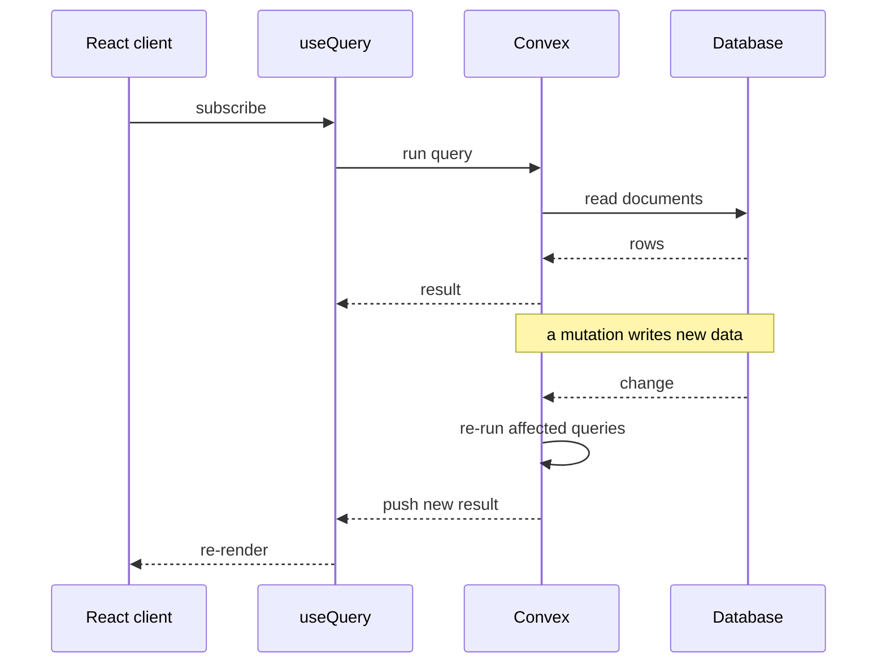

## What Convex does

Convex combines a real-time database, serverless functions, and reactive queries in one SDK. A query result stays synchronised to every connected client, so live data needs no polling and no WebSocket server of your own.

### The usual stack

A real-time feature normally needs a database, a WebSocket server, pub/sub infrastructure, client state management, and optimistic update logic. Each one is a service to run and a failure mode to handle.

### With Convex

Write a query, call it from React, and the client stays current:

```typescript
// convex/projects.ts
import { query } from "./_generated/server"
import { v } from "convex/values"

export const getProjects = query({
  args: { category: v.optional(v.string()) },
  handler: async (ctx, args) => {
    if (args.category) {
      return await ctx.db
        .query("projects")
        .filter(q => q.eq(q.field("category"), args.category))
        .collect()
    }
    return await ctx.db.query("projects").collect()
  },
})
```

```tsx
// components/ProjectList.tsx
import { useQuery } from "convex/react"
import { api } from "@/convex/_generated/api"

export function ProjectList() {
  const projects = useQuery(api.projects.getProjects, { category: "web" })
  if (projects === undefined) return <div>Loading...</div>
  return projects.map(p => <ProjectCard key={p._id} project={p} />)
}
```

## Reactive queries

Every `useQuery` hook subscribes to the data it read. When a mutation changes that data, Convex re-runs the query and pushes the new result to all connected clients.



```typescript
// convex/submissions.ts
import { mutation } from "./_generated/server"

export const submitContact = mutation({
  args: {
    name: v.string(),
    email: v.string(),
    message: v.string(),
  },
  handler: async (ctx, args) => {
    const identity = await ctx.auth.getUserIdentity()
    // Rate limiting is handled by the platform
    await ctx.db.insert("submissions", {
      ...args,
      userId: identity?.subject,
      createdAt: Date.now(),
    })
  },
})
```

## Collaborative features

### Live cursors

```typescript
// convex/cursors.ts
export const updateCursor = mutation({
  args: { x: v.number(), y: v.number() },
  handler: async (ctx, args) => {
    const identity = await ctx.auth.getUserIdentity()
    await ctx.db.insert("cursors", {
      userId: identity?.subject,
      x: args.x,
      y: args.y,
      updatedAt: Date.now(),
    })
  },
})

export const getActiveCursors = query({
  handler: async (ctx) => {
    const fiveSecondsAgo = Date.now() - 5000
    return await ctx.db
      .query("cursors")
      .filter(q => q.gte(q.field("updatedAt"), fiveSecondsAgo))
      .collect()
  },
})
```

## Schema design

The schema is TypeScript, and the types flow into the queries:

```typescript
// convex/schema.ts
import { defineSchema, defineTable } from "convex/server"
import { v } from "convex/values"

export default defineSchema({
  projects: defineTable({
    title: v.string(),
    description: v.string(),
    category: v.string(),
    technologies: v.array(v.string()),
    imageUrl: v.optional(v.string()),
  }).index("by_category", ["category"]),

  testimonials: defineTable({
    name: v.string(),
    role: v.string(),
    content: v.string(),
    avatar: v.optional(v.string()),
  }),
})
```

## Where it fits

| Use case | Fit | Alternative |
|---|---|---|
| Real-time dashboards | Strong | WebSockets and Redis |
| Collaborative editing | Strong | CRDTs and WebRTC |
| Contact forms | Good, with built-in rate limiting | Serverless functions |
| Blog CMS | Adequate | Headless CMS |
| File storage | Needs an external service | S3 or Cloudinary |
| Heavy analytics | Query limits apply | Data warehouse |

## Summary

Convex removes the WebSocket server, the pub/sub layer, and the client-side sync logic from a real-time feature. When live data is central to the product, as in collaboration tools or live dashboards, that is less code to own than assembling the pieces from separate services.
