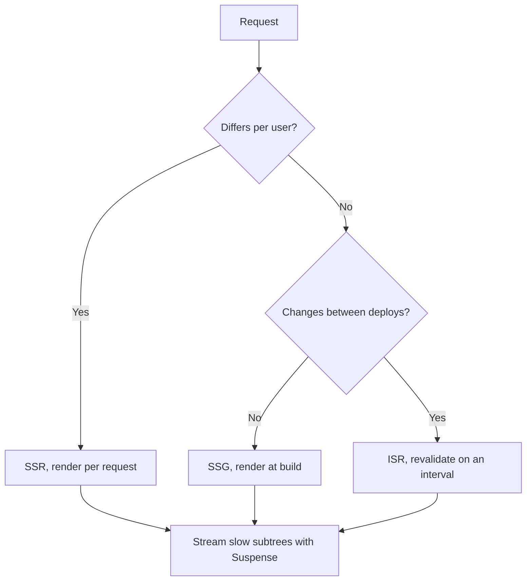

## What Next.js provides

Next.js supplies file-based routing, server and client rendering in the same tree, per-route code splitting, and image and font optimisation. Most production React applications need all four, which is why it is a common default.

### The parts that matter

- File-based routing, which removes a routing table from the code
- Server Components, which keep component code out of the client bundle
- Automatic code splitting per route
- Image, font, and script optimisation with no extra setup

## Architecture

### Project structure

The layout should make the boundary between routing, UI, and utilities obvious:

```
src/
├── app/          # App Router pages
├── components/   # Reusable UI components
├── lib/          # Utility functions
├── data/         # Static data and configuration
├── hooks/        # Custom React hooks
└── providers/    # Context providers
```

The rule this layout encodes: `app/` decides what renders, `components/` decides how it looks, and `lib/` holds the code that has no React dependency.

### Server Components first

With [React Server Components](/blog/what-are-react-server-components), data is fetched on the server and only the rendered output reaches the client. Component code and its dependencies stay off the browser.

```tsx
// app/posts/[id]/page.tsx
export default async function PostPage({ params }: { params: Promise<{ id: string }> }) {
  const { id } = await params
  const post = await getPost(id)
  return <article>{post.content}</article>
}
```

### Data fetching strategies

| Strategy | Use case | When it fits |
|---|---|---|
| Static (SSG) | Blog posts, documentation | Content rarely changes |
| Dynamic (SSR) | User dashboards, live data | Every request needs fresh data |
| Incremental (ISR) | E-commerce, news | Freshness with a cache in front |

The choice follows from two questions: whether the content differs per user, and whether it changes between deploys.



## Performance

1. Serve images through `next/image` with explicit dimensions.
2. Stream slow subtrees with `loading.tsx` and `Suspense` boundaries.
3. Check bundle size on every release, not once at the end.

## Where to start

Begin with Server Components and push Client Components to the leaves. Add caching and streaming where a measurement shows they help. The structure above scales because each directory has one job, and the rendering strategy is a per-route decision rather than a framework-wide one.
