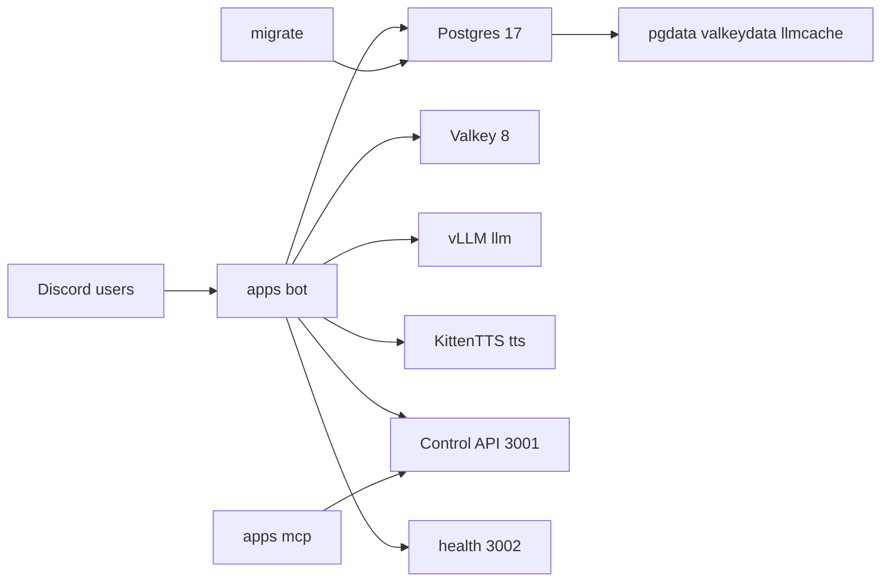
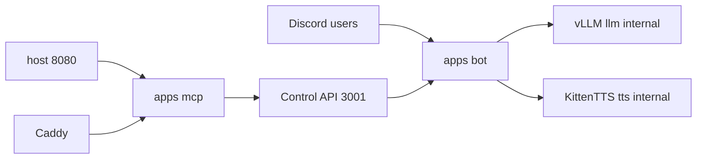
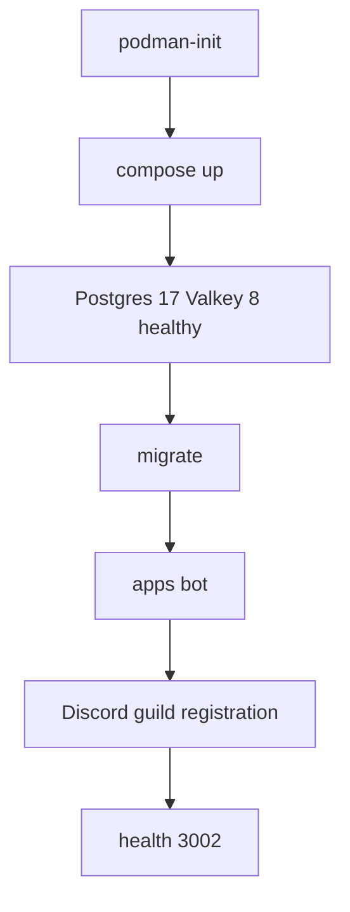

Siela is a single-guild Discord bot, and it is the load-generating workload for a hardened self-hosting stack: rootless Podman 5, Postgres 17, Valkey 8, local vLLM and TTS sidecars, one-shot migrations, and overlay composes for MCP and Caddy. The bot has 59 registered commands, 58 of them slash-enabled, plus 90-ball Tambola and a Siela Coins economy. This post is about the infrastructure underneath it.

The build is documented in [siela-bot](https://github.com/DeathSurfing/siela-bot). The scope is one guild and one deployable stack, with no managed services beyond a single VPS. `DISCORD_TOKEN` is the only secret supplied as input; the init script generates the rest.

## What the stack runs

Playback uses yt-dlp for extraction and mpv for decoding, and both ship in the bot image, so nothing external is needed at runtime. That makes SoundCloud work without configuration, and YouTube, YouTube Music, and Spotify playlists or albums can be imported straight into the queue.

The main playback commands are `join`, `queue`, `clearqueue`, and `nowplaying`, with the aliases `current`, `currentlyplaying`, `cp`, and `np`. The Lyrics button fetches from LRCLIB when the current track has lyrics. A now-playing message carries pause, resume, skip, a More select for seek back and forward by 10 seconds, shuffle, loop, and filters, and stop. Filters apply live through mpv, so changing one does not restart the track.

Queue persistence depends on the command. `stop` clears the queue stored in Valkey, `disconnect` keeps it, and the next player creation restores whatever is left. Neither resumes the playback position. Containerising this class of Node service is covered in [Docker for frontend developers](/blog/docker-for-frontend-developers).

```ts
// Illustrative example: same shape as Siela command handlers
import { SlashCommandBuilder, type ChatInputCommandInteraction } from "discord.js";

export const data = new SlashCommandBuilder()
  .setName("queue")
  .setDescription("Show the current music queue");

export async function execute(interaction: ChatInputCommandInteraction) {
  // Production: read Valkey-backed queue, check guild scope, reply with paged list.
  // See apps/bot/src/commands/music/music.ts in the repo.
  await interaction.reply("Queue lookup goes here.");
}
```

Tambola is the 90-ball variant: one game per guild, 2 to 20 players, and tickets sent by DM so game state stays out of public channels. Auto-marking is on by default and can be toggled in the lobby. Numbers are called every 12 seconds by default, or 8 on fast and 15 on slow, with a live called board and TTS calls.

The win patterns are Top Line, Middle Line, Bottom Line, and Full House. Tickets use the standard 3x9 layout: five numbers per row, one to three per column, columns covering 1 to 9 through 80 to 90, sorted ascending and generated on the server with `crypto.randomInt`. Prices are fixed: an extra ticket costs 25 Siela Coins, and per-player auto-mark costs 10 SC per game. The server validates every claim, and Full House ends the game.

Voice coordination affects the infrastructure. When the lobby opens, Tambola joins the selected voice channel, stops the music, and locks the music voice, so random voice drops and scheduled events are skipped while the lock is held. Active games live in memory only, which means a restart cancels them.

## The economy and its ledger

Siela Coins keep one balance per user per guild. Every balance change writes an immutable row to `economy_transactions` in the same database transaction, so the ledger and the balance cannot disagree. Postgres, through Drizzle, is the source of truth: `economy_accounts`, `economy_transactions`, `premium_passes`, and the shop tables. Valkey caches each balance for 60 seconds and the leaderboard for 30, and Postgres stays authoritative when Valkey is unavailable.

| feature | cost | source of truth |
|---|---|---|
| Tambola ticket | 25 SC | Postgres ledger |
| Tambola auto-mark | 10 SC per game | Postgres ledger |
| Delulu generation | 5 SC, 15 SC NSFW in NSFW channel | Postgres ledger, refunded on failure |
| Premium | 2000 SC for 30 days | Postgres `premium_passes` |
| Music queue persistence | free | Valkey, restored on player create |
| Daily / work | earn 10-70 SC / 1-4 SC | Postgres, race-safe claims |

Coins are earned through a few fixed mechanisms. `daily` gives a 10 SC base with a streak multiplier of up to 7x and a 24-hour cooldown. `work` gives 1 to 4 SC with a 2-hour cooldown, and capped social and per-command awards add to that, along with `transfer` for 1 to 1,000,000 SC. Games of chance have fixed odds: `coinflip` at 45% for 2x, `slots` at 2x for a pair and 5x for a triple, and `blackjack` at 2x with a floored 2.5x blackjack payout, where in-memory hands are lost on restart. Premium is status only, so it does not exempt anyone from costs or cooldowns. The storage split follows the same Postgres-first approach as [replacing the stack with Postgres](/blog/replaced-my-entire-stack-with-postgres).

Outside games, the bot handles social commands (`slap`, `kiss`, `hug`, pair counters, a leaderboard, opt-out, `lovecalc`, birthday wishes), Friendship Levels, a Confession Wall, welcomer image cards, auto-role with hierarchy checks, join-to-create temporary voice channels, and 90-day activity monitoring.

## Internal AI sidecars

`/delulu` generates scenarios through a local vLLM service running `Goekdeniz-Guelmez/Josiefied-Qwen2.5-1.5B`. Each call costs 5 SC, or 15 SC for NSFW in an NSFW channel, and a failed call is refunded. No Hugging Face token is needed. The OpenAI-compatible endpoint has no authentication because it is reachable only on the internal compose networks and is never published to the host.

TTS is a separate path, toggled with `/tts on|off` and played in the voice channel. The primary voice is KittenTTS Nano ONNX with the Bruno voice, served by the local `tts` service, with Edge TTS (`en-IN-NeerjaNeural`) as fallback. Its `/synthesize` endpoints are also unauthenticated and internal only. Tambola calls use the same path, so a silent call usually means a voice-channel permission problem or a down TTS service, not a game-logic fault.

## Stack topology

The codebase is a TypeScript monorepo with shared contracts:

- `apps/bot`: discord.js gateway, feature services, control API on `:3001`, health and metrics on `:3002`
- `apps/mcp`: MCP server over stdio and Streamable HTTP, with a tool catalog and no Discord token or database credentials
- `packages/shared`: Zod schemas, types, constants
- `packages/db`: Drizzle schema, migrations, Postgres client
- `packages/config`: Zod environment validation, with `*_FILE` variants for secrets
- `deploy/podman`: compose files, Containerfiles, optional overlays



The hardening follows from the threat model. The bot container runs read-only with `/tmp` as tmpfs, drops all capabilities, and sets `no-new-privileges`. MCP sits on the internal `mcp` network behind one generated `MCP_TOKEN`; destructive tools require `confirm: true`, and every mutation is audited. Control API routes require `Authorization: Bearer <MCP_TOKEN>`, and health exposes `/healthz`, `/readyz`, and `/metrics`. Secrets live in a generated `.env` with 600 permissions, Pino redacts them from logs, and `pg_dump` backs up Postgres.



The money-safety layering follows the same fail-closed reasoning as [making a merchant agent buyable](/blog/making-a-merchant-agent-buyable).

## Compose, overlays, and boot

Production is defined in `deploy/podman`: `postgres`, `valkey`, `llm`, `tts`, `bot`, and a one-shot `migrate` service. MCP and Caddy are optional overlays, with `compose.mcp.yaml`, `compose.host.yaml` for `127.0.0.1:8080`, and `compose.proxy.yaml` for the Caddy TLS front door. Everything runs rootless on Podman 5 with cgroups v2.

The runbook has one quickstart path:

```bash
export DISCORD_TOKEN="..."
./scripts/podman-init.sh
./scripts/podman-stack.sh up -d --build
```

`DISCORD_TOKEN` is the only required input. The init script derives the client ID, prints an invite URL, generates the internal Postgres and MCP secrets, and writes a `.env` with 600 permissions. It detects `GUILD_ID` when the bot belongs to exactly one guild. Run every compose operation through `scripts/podman-stack.sh` so overlay selection is honoured.



On a host without `/dev/net/tun`, build the image with host networking (`podman build --network=host`). Remote Podman Desktop connects over SSH with a rootful socket. Single-service VPS deployment is covered in [K3s bare metal](/blog/k3s-bare-metal).

`docs/RUNBOOK.md` defines the verification sequence:

- `pg_isready` for Postgres
- `valkey-cli ping`
- `http://llm:8000/health`
- `http://tts:8000/healthz`
- `/healthz` and `/readyz` on port 3002 inside the bot container
- `./scripts/podman-stack.sh run --rm migrate` for the idempotent one-shot migrations

## Failure modes

The rule is that a missing Valkey, LLM, MCP, music binary, TTS service, or event audio must never take down the bot. Three failures in the runbook shaped the final behaviour:

- Music silent but the queue advancing: `yt-dlp` or `mpv` missing, or Spotify metadata unresolvable. The fix was to bake both binaries into the bot image and resolve Spotify tracks through public oEmbed and embed metadata before matching them to YouTube. No Spotify credentials are required.
- Tambola TTS silent: a missing Connect or Speak permission, or the `tts` service down. The fix was to check the lobby card's TTS line first, then the `tts` health endpoint and `TTS_SERVICE_URL`, with Edge TTS as the fallback path.
- Delulu failing: the `siela-llm` container down or vLLM unhealthy. The fix was to keep migrations in a one-shot container that retries database readiness instead of migrating on app boot.

Code: [github.com/DeathSurfing/siela-bot](https://github.com/DeathSurfing/siela-bot)

## Ops FAQ

### What stack is this?

A rootless Podman 5 compose of Postgres 17, Valkey 8, local vLLM and KittenTTS sidecars, a read-only Bun 1.x bot, one-shot Drizzle migrations, and optional MCP and Caddy overlays. Source and runbooks are in the [repo](https://github.com/DeathSurfing/siela-bot); related builds are listed under [/projects](/projects).

### How do slash and prefix commands coexist?

Every command is hybrid: prefix, slash, context menu, and mention prefix all resolve to the same handler. `test` is the only prefix-only command, which is why the total is 59 registered commands but 58 slash-enabled.

### Do I need MCP?

No. For Discord-only operation, keep `MCP_ENABLED=false`. Enable the `mcp` overlay only when you need the 51 control tools, served over the internal `mcp` network behind `MCP_TOKEN`, with an optional host overlay on `127.0.0.1:8080`.
