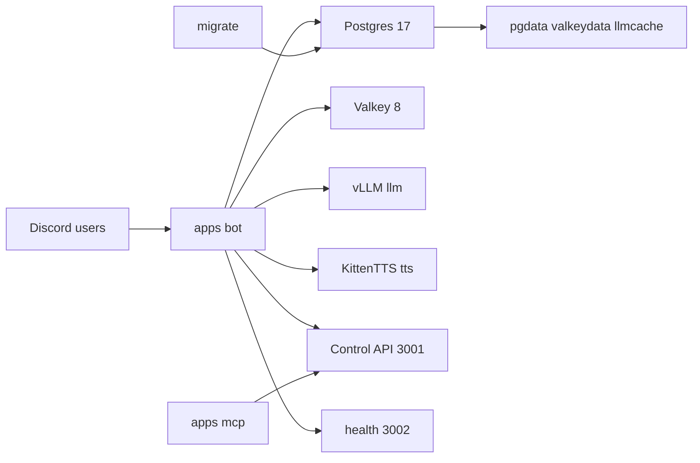
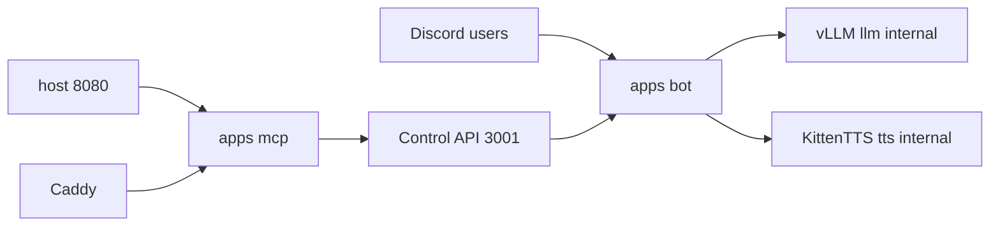
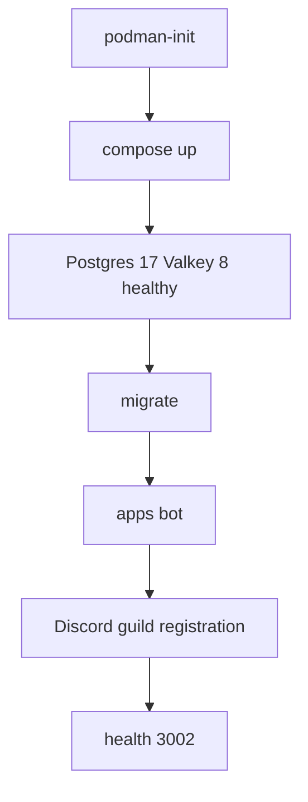

Siela is a single-guild Discord bot that serves as the load-generating workload for a hardened self-hosting stack built on rootless Podman 5, Postgres 17, Valkey 8, local vLLM and TTS sidecars, one-shot migrations, and overlay composes for MCP and Caddy. The bot itself provides 59 registered commands (58 slash-enabled; `test` is prefix-only), 90-ball Tambola, and a Siela Coins economy. This post examines the infrastructure that sustains it.

This post documents the build for [siela-nogseuui-seobeo-bot](https://github.com/DeathSurfing/siela-nogseuui-seobeo-bot). The scope is deliberately narrow: one guild, one deployable stack, and no managed services beyond a single VPS. A single `DISCORD_TOKEN` is supplied as input; as a result, all remaining secrets are generated during initialization.

## Demo workload: what the infra runs

Playback rests on two fundamental mechanisms: yt-dlp for extraction and mpv for decoding, both of which are shipped in the bot image. This arrangement matters because it removes external decoder dependencies at runtime. SoundCloud is therefore supported without further configuration; furthermore, YouTube and YouTube Music playlists as well as Spotify playlists and albums can be imported directly into the queue.

The core playback interface consists of `join`, `queue`, `clearqueue`, and `nowplaying` (aliases `current`, `currentlyplaying`, `cp`, `np`). Lyrics are retrieved from LRCLIB through the Lyrics button when available for the current track. Now-playing messages expose pause, resume, skip, a More select (seek back/forward 10s, shuffle, loop, filters), and stop. Filters are significant because they apply live through mpv, which means adjustment does not require restarting the track.

Persistence follows an explicit distinction. The upcoming queue is saved in Valkey and restored when the bot next creates a player. However, `stop` clears that stored queue, whereas `disconnect` preserves it. The current playback position is not resumed in either case. Background on containerizing this class of Node service is available in [Docker for frontend developers](/blog/docker-for-frontend-developers).

```ts
// Illustrative example — same shape as Siela command handlers
import { SlashCommandBuilder, type ChatInputCommandInteraction } from "discord.js";

export const data = new SlashCommandBuilder()
  .setName("queue")
  .setDescription("Show the current music queue");

export async function execute(interaction: ChatInputCommandInteraction) {
  // Production: read Valkey-backed queue, check guild scope, reply with paged list.
  // See apps/bot/src/commands/music/music.ts in the repo.
  await interaction.reply("Queue lookup goes here.");
}
```

Tambola implements the 90-ball variant, with one game permitted per guild and 2–20 players supported. Tickets are distributed by DM, which keeps game state out of public channels. Auto-marking is enabled by default and remains toggleable in lobby settings. Calls occur every 12 seconds by default (fast 8s, slow 15s), accompanied by a live called board and runtime TTS calls.

The supported win patterns are Top Line, Middle Line, Bottom Line, and Full House. Tickets follow the standard 3x9 layout: 5 numbers per row, 1–3 numbers per column, column ranges `1–9` through `80–90`, sorted ascending and generated server-side with `crypto.randomInt`. The pricing mechanism is fixed: extra tickets cost 25 Siela Coins, while per-player auto-mark costs 10 SC per game. Claims are validated server-side, and Full House terminates the game.

Voice coordination has direct infrastructural implications. Tambola joins the selected voice channel when the lobby opens, stops music, and locks the music voice; as a result, random VC drops and scheduled events are skipped while the lock is active. Active games reside in memory only. A restart therefore cancels them.

## Economy and ledger

Siela Coins (SC) maintains one balance per user per guild. The central guarantee is ledger integrity: every balance change writes an immutable row to `economy_transactions` within the same database transaction. Postgres, accessed via Drizzle, is the source of truth (`economy_accounts`, `economy_transactions`, `premium_passes`, shop tables). Valkey caches balance for 60s and leaderboard for 30s. However, the database remains authoritative when Valkey is unavailable.

| feature | cost | source of truth |
|---|---|---|
| Tambola ticket | 25 SC | Postgres ledger |
| Tambola auto-mark | 10 SC per game | Postgres ledger |
| Delulu generation | 5 SC, 15 SC NSFW in NSFW channel | Postgres ledger, refunded on failure |
| Premium | 2000 SC for 30 days | Postgres `premium_passes` |
| Music queue persistence | free | Valkey, restored on player create |
| Daily / work | earn 10–70 SC / 1–4 SC | Postgres, race-safe claims |

Earning proceeds through several defined mechanisms. `daily` provides a 10 SC base with up to 7x streak and a 24h cooldown, while `work` yields 1–4 SC with a 2h cooldown, supplemented by capped social and per-command awards and `transfer` (1–1,000,000 SC). Games of chance follow fixed odds: `coinflip` (45% win, 2x), `slots` (pair 2x, triple 5x), and `blackjack` (2x, blackjack 2.5x floored, with in-memory hands lost on restart). Premium is status-only, which means all users remain subject to costs and cooldowns. The storage split mirrors the Postgres-first approach described in [replaced my entire stack with Postgres](/blog/replaced-my-entire-stack-with-postgres).

Beyond games, the same guild-scoped bot provides social interaction (`slap`, `kiss`, `hug`, pair counters, leaderboard, opt-out, `lovecalc`, birthday wishes), Friendship Levels, a Confession Wall, welcomer image cards, auto-role with hierarchy checks, join-to-create temporary VCs (`jointocreate` / `j2c`), and 90-day activity monitoring.

## Internal-only AI sidecars

`/delulu` generates scenarios through a local vLLM service running `Goekdeniz-Guelmez/Josiefied-Qwen2.5-1.5B`. Each invocation costs 5 SC (15 SC for NSFW in an NSFW channel), refunded on failure. No Hugging Face token is required. The OpenAI-compatible endpoint carries no authentication because its exposure is constrained: it is reachable only on the internal compose networks and is never published to the host.

TTS operates as a standalone path via `/tts on|off` together with in-voice playback. The primary voice is KittenTTS Nano ONNX (voice Bruno) served through the local `tts` service, with Edge TTS (`en-IN-NeerjaNeural`) as fallback. Its `/synthesize` endpoints are likewise unauthenticated and internal-only. Tambola calls use the same path; consequently, a silent Tambola call generally indicates a voice-channel permission or TTS service issue rather than a game-logic fault.

## Stack topology

The codebase is organized as a TypeScript monorepo with shared contracts:

- `apps/bot` — discord.js gateway, feature services, control API (`:3001`), health/metrics (`:3002`)
- `apps/mcp` — MCP server (stdio + Streamable HTTP) and tool catalog, no Discord token or DB credentials
- `packages/shared` — Zod schemas, types, constants
- `packages/db` — Drizzle schema, migrations, Postgres client
- `packages/config` — Zod environment validation (`*_FILE` variants read secrets from files)
- `deploy/podman` — compose files, Containerfiles, optional overlays



Hardening follows directly from the threat model. The bot container runs read-only with `/tmp` as tmpfs, drops all capabilities, and sets `no-new-privileges`. MCP resides on the internal `mcp` network behind a single generated `MCP_TOKEN`, with `confirm: true` required for destructive tools and every mutation audited. Control API routes require `Authorization: Bearer <MCP_TOKEN>`, while health exposes `/healthz`, `/readyz`, and `/metrics`. Secrets are stored in a generated 600-permission `.env`, Pino redacts them from logs, and Postgres is backed up with `pg_dump`.



The money-safety layering reflects the same fail-closed reasoning examined in [making a merchant agent-buyable](/blog/making-a-merchant-agent-buyable).

## Compose, overlays, and boot

Production is defined in `deploy/podman` compose, comprising `postgres`, `valkey`, `llm`, `tts`, `bot`, and a one-shot `migrate` service. MCP and Caddy are optional overlays (`compose.mcp.yaml`, `compose.host.yaml` for `127.0.0.1:8080`, `compose.proxy.yaml` for the Caddy TLS front door). The entire composition runs rootless on Podman 5 with cgroups v2.

The runbook defines a single quickstart path:

```bash
export DISCORD_TOKEN="..."
./scripts/podman-init.sh
./scripts/podman-stack.sh up -d --build
```

Only `DISCORD_TOKEN` is required as input. The init script derives the client ID, prints an invite URL, generates internal Postgres and MCP secrets, and writes a 600-permission `.env`. `GUILD_ID` is auto-detected when the bot belongs to exactly one guild. Furthermore, all compose operations should use `scripts/podman-stack.sh` so that overlay selection is honored.



On hosts without `/dev/net/tun`, the image should be built with host networking (`podman build --network=host`); remote Podman Desktop operates over SSH with a rootful socket. Background on single-service VPS deployment is available in [k3s bare metal](/blog/k3s-bare-metal).

`docs/RUNBOOK.md` defines the verification sequence: `pg_isready` for Postgres, `valkey-cli ping`, `http://llm:8000/health`, `http://tts:8000/healthz`, `/healthz` and `/readyz` on port 3002 inside the bot container, and `./scripts/podman-stack.sh run --rm migrate` for the idempotent one-shot migrations.

## Failure modes and graceful degradation

The governing principle is that absent Valkey, LLM, MCP, music binaries, TTS, or event audio must never take down the bot. Three failures documented in the runbook shaped this final behavior:

- Music silent but queue advancing: `yt-dlp` or `mpv` missing or Spotify metadata unresolvable. Fixed by baking both into the bot image and resolving Spotify tracks through public oEmbed and embed metadata, then matching to YouTube. No Spotify credentials required.
- Tambola TTS silent: missing Connect/Speak permission or `tts` service down. Fixed by checking the lobby card TTS line first, then `tts` health and `TTS_SERVICE_URL`, with Edge TTS as the fallback path.
- Delulu failing: `siela-llm` container down or vLLM unhealthy. Fixed by checking container logs and `http://llm:8000/health`, plus keeping migrations as a one-shot container that retries DB readiness instead of migrating on app boot.

Code: [github.com/DeathSurfing/siela-nogseuui-seobeo-bot](https://github.com/DeathSurfing/siela-nogseuui-seobeo-bot)

## Ops FAQ

### What stack is this?

The stack is a rootless Podman 5 compose comprising Postgres 17, Valkey 8, local vLLM and KittenTTS sidecars, a read-only Bun 1.x bot, one-shot Drizzle migrations, and optional MCP and Caddy overlays. Source and runbooks are maintained in the [repo](https://github.com/DeathSurfing/siela-nogseuui-seobeo-bot); related builds are listed under [/projects](/projects).

### How do slash and prefix commands coexist?

Every command is hybrid in design: prefix, slash, context menu, and mention prefix resolve to the same handler. However, `test` is the only prefix-only command, which explains why the total is 59 registered commands but 58 slash-enabled.

### Do I need MCP?

No. For Discord-only operation, retain `MCP_ENABLED=false`. Enable the `mcp` overlay only when the 51 control tools are required, served over the internal `mcp` network behind `MCP_TOKEN`, with an optional host overlay on `127.0.0.1:8080`.
