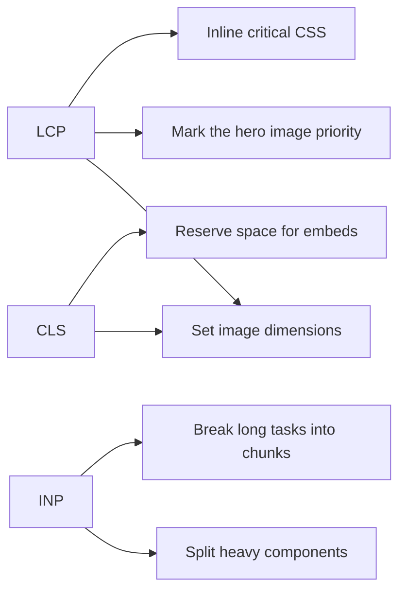

## Core Web Vitals

Core Web Vitals are the field metrics Google uses to describe loading, interactivity, and visual stability. They matter to search ranking and to what a user experiences on a slow connection.

### The three metrics

1. Largest Contentful Paint (LCP) measures loading.
2. Interaction to Next Paint (INP) measures responsiveness.
3. Cumulative Layout Shift (CLS) measures visual stability.

## LCP

LCP is the time until the largest visible element, usually an image or a text block, is rendered. The threshold for a good score is 2.5 seconds.

### Images

```tsx
import Image from 'next/image'

// Bad: no size hints


// Good: explicit dimensions, priority for the hero image
<Image
  src="/hero.jpg"
  alt="Hero"
  width={1200}
  height={630}
  priority
  className="border-2 border-border rounded"
/>
```

Declaring the dimensions lets the browser reserve space before the file arrives, which helps LCP and CLS at the same time.

### Critical CSS

Inline the CSS for above-the-fold content in the `<head>` so the first paint does not wait on a stylesheet:

```html
<style>
  /* Critical styles only */
  html { font-family: sans-serif }
  .hero { display: flex; min-height: 80vh }
</style>
```

## CLS

CLS measures unexpected layout movement. The threshold for a good score is 0.1.

### Give every image dimensions

```css
/* Bad: causes layout shift */
img { width: 100% }

/* Good: reserves space */
img {
  width: 100%;
  height: auto;
  aspect-ratio: 16 / 9;
}
```

### Reserve space for embeds

```tsx
// Reserve space for embeds
<div style={{ aspectRatio: '16/9', maxWidth: '560px' }}>
  <YouTubeEmbed videoId="dQw4w9WgXcQ" />
</div>
```

## INP

INP is the time from a user interaction to the browser painting the next frame. The threshold for a good score is 200 milliseconds.

### Split the code

```tsx
// Dynamic import for heavy components
const HeavyChart = dynamic(() => import('@/components/Chart'), {
  loading: () => <ChartSkeleton />,
  ssr: false,
})
```

### Break up long tasks

A single task that runs longer than 50 milliseconds blocks the main thread, so input is queued behind it. Split the work across tasks:

```typescript
function processItems(items: Item[]) {
  let i = 0
  function chunk() {
    const end = Math.min(i + 50, items.length)
    while (i < end) {
      process(items[i])
      i++
    }
    if (i < items.length) {
      setTimeout(chunk, 0)
    }
  }
  chunk()
}
```

`setTimeout`, `requestIdleCallback`, and `scheduler.yield()` all let the browser paint between chunks.

## Measuring

| Tool | What it measures | How it runs |
|---|---|---|
| Lighthouse | Lab audit of a single load | Automated |
| Web Vitals library | Real user measurements | In the page |
| Chrome DevTools | Detailed profiling | Manual |

Lab tools tell you what could be slow. Field data tells you what is slow for the people using the site. Measure in the field first, then reproduce the largest problem in the lab.

## Where to spend the effort

Each metric maps to a short list of levers. Start with the one that matches the failing number.



Measure first, fix the bottleneck the measurement identifies, then measure again. Most sites only need two or three of the techniques above, and which two depends on which metric is failing.
