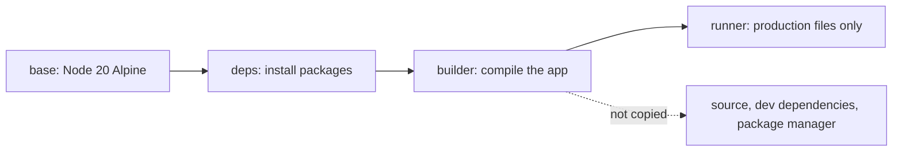

## Why a frontend needs Docker

A frontend application now has the environment problems a backend service has. It depends on a Node version, system libraries, build tools, and environment variables, and a server-side rendering step means the build and the runtime both matter. Docker packages all of it into one artefact that runs the same way on a laptop and on a server.

### The problem it removes

Different Node versions, operating systems, and system libraries produce bugs that appear on one machine only. Docker puts the runtime next to the application, so the version of Node and the system libraries travel with the code.

## A Dockerfile for Next.js

```dockerfile
FROM node:20-alpine AS base

# Install dependencies only when needed
FROM base AS deps
WORKDIR /app
COPY package.json bun.lock ./
RUN bun install --frozen-lockfile

# Build the application
FROM base AS builder
WORKDIR /app
COPY --from=deps /app/node_modules ./node_modules
COPY . .
RUN bun run build

# Production image
FROM base AS runner
WORKDIR /app
ENV NODE_ENV=production
COPY --from=builder /app/public ./public
COPY --from=builder /app/.next/standalone ./
COPY --from=builder /app/.next/static ./.next/static

EXPOSE 3000
CMD ["node", "server.js"]
```

### Multi-stage builds

The stages above keep the final image small by discarding the build tools and the intermediate layers:

| Stage | Purpose | Size |
|---|---|---|
| `base` | Node image with system dependencies | ~150 MB |
| `deps` | Install dependencies | Adds ~200 MB, discarded |
| `builder` | Compile the app | Adds ~50 MB, discarded |
| `runner` | Production image with only runtime files | ~180 MB final |

The `runner` stage copies from `builder` rather than from the build context, so source files, dev dependencies, and the package manager never reach production. Only the last stage survives into the image.



## Compose for development

```yaml
# docker-compose.yml
services:
  app:
    build:
      context: .
      target: deps
    ports:
      - "3000:3000"
    volumes:
      - .:/app
      - /app/node_modules
    environment:
      - NODE_ENV=development
      - CONVEX_URL=${CONVEX_URL}
    command: bun run dev

  db:
    image: postgres:16-alpine
    volumes:
      - postgres_data:/var/lib/postgresql/data
    environment:
      POSTGRES_DB: myapp
      POSTGRES_PASSWORD: secret

volumes:
  postgres_data:
```

The anonymous volume on `/app/node_modules` keeps the container's dependencies separate from the host directory, so a bind mount of the source does not replace them.

## Commands you will use daily

```bash
# Build the image
docker build -t my-app .

# Run the container
docker run -p 3000:3000 my-app

# Development with compose
docker compose up

# List running containers
docker ps

# View logs
docker logs -f my-app

# Clean up
docker system prune -a
```

## Next.js specifics

### Standalone output

Next.js can produce a [standalone output](https://nextjs.org/docs/app/api-reference/next-config-js/output) containing only the files the production server needs:

```javascript
// next.config.js
module.exports = {
  output: "standalone",
}
```

That output is what the multi-stage Dockerfile copies into the final image.

### Environment variables

```dockerfile
# Build-time args
ARG NEXT_PUBLIC_SITE_URL
ENV NEXT_PUBLIC_SITE_URL=$NEXT_PUBLIC_SITE_URL

# Runtime env vars (can be overridden at deployment)
ENV DATABASE_URL=""
ENV AUTH_SECRET=""
```

`NEXT_PUBLIC_` values come from the build stage, so they are fixed when the image is built. Everything else can change at deploy time.

## Building in CI

```yaml
# .github/workflows/deploy.yml
name: Deploy
on:
  push:
    branches: [main]

jobs:
  deploy:
    runs-on: ubuntu-latest
    steps:
      - uses: actions/checkout@v4
      
      - name: Build Docker image
        run: docker build -t my-app .
      
      - name: Deploy to server
        run: |
          docker save my-app | ssh user@server docker load
          ssh user@server "docker compose up -d"
```

## Practices worth keeping

1. Add a `.dockerignore` for `node_modules`, `.next`, and `.git`.
2. Pin base images to a version, such as `node:20-alpine`, rather than `latest`.
3. Order the instructions from least to most frequently changed, so dependency layers cache.
4. Add a `HEALTHCHECK` so a failing container is visible.
5. Create a non-root user and run the app as that user.

## Summary

Docker removes the difference between your machine and the server. Start with one Dockerfile, add Compose when the app needs a database, and add the deploy workflow once the image builds reliably.
