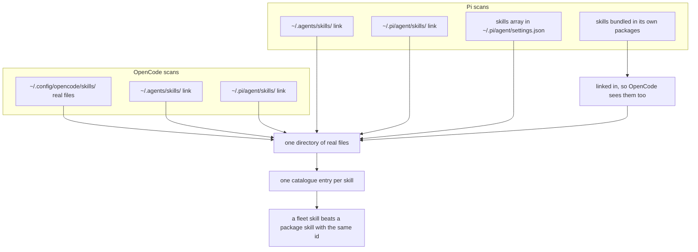
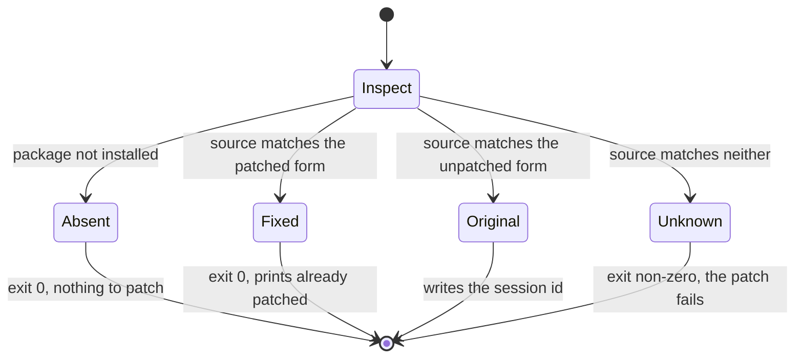
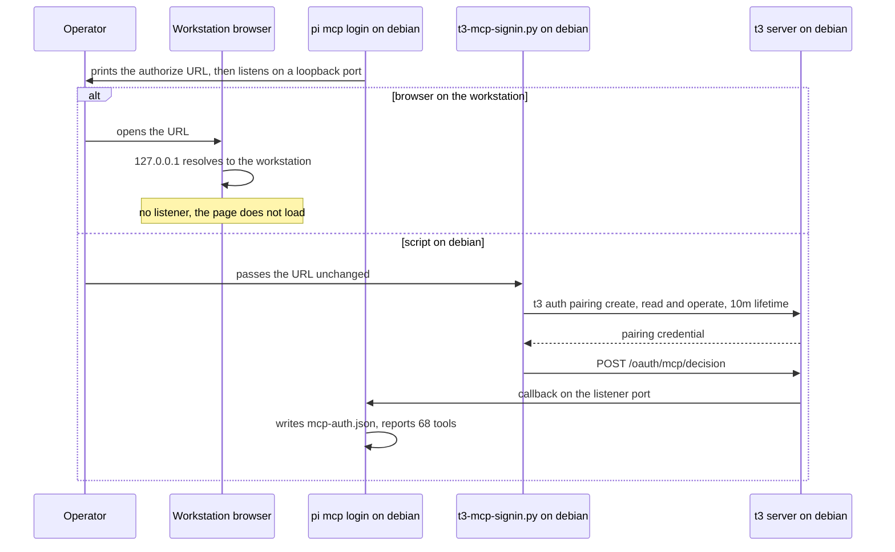

The `.fleet` repository began as a backup. At commit `e02fa44` it was called `.skills`, its README described a private backup of an agent skill library, and the restore step was a single instruction. Copy the skill directory you need into the agent's skills directory.

That works for one agent on one machine, and it fails for a reason worth stating plainly. A copy cannot report that it is stale. Two copies of one library, one in git and one in a home directory, leave no command that can say which is current, and nothing fails when they disagree.

The fleet it now serves is three machines. `debian` is an always-on Debian 13 server running T3 Code, OpenCode, pstack and Pi. `vikkonwindows` and `vikkonmac` run only the T3 client and reach it over the `DeathSurfing` tailnet. What follows is a sequence of approaches that looked correct, the mechanism that broke each, and the decision that replaced it.

## The backup accumulated state it could not describe

The first problem was scope rather than drift. A repository with no rule about what belongs inside it accumulates whatever the person using it needs that week, and `.skills` had come to hold `profiles/coder/`, a complete agent home directory with `SOUL.md` and `config.yaml`, resume files, `cron/jobs.json`, two memory files and a set of Apple-specific skills.

None of that is wrong to keep. It is wrong to keep beside the file that tells three machines which skills exist, because a live memory file and a skill definition have different owners and different lifetimes. Commit `8d085e7` drew the boundary, changing 356 files with 188 insertions against 82,522 deletions and taking the skill count from 144 to 94. The library now holds 167 skills across 16 categories, 67 of them a snapshot of the pstack plugin.

Everything kept has to be reasoned about on every later change, so a directory nobody audits costs attention each time someone reads the tree. Where an old skill duplicated plugin behaviour I deleted my copy and pointed the reference at the plugin, since two ids for one capability is a second way for two devices to disagree while looking identical.

## One library, several discovery paths

`scripts/sync-skills.sh` copies from `skills/` to `~/.config/opencode/skills/`, and that directory is the only place real skill files live. Every other discovery path is a link into it.

Which paths exist is not obvious. OpenCode scans its own config directory, `~/.agents/skills/` and `~/.pi/agent/skills/`. Pi scans the last two, adds any path named in the `skills` array of `~/.pi/agent/settings.json`, and includes the skills that ship inside its own packages.



Nothing forces the two lists to agree, and no command reports the difference when they stop. The naive arrangement is one real copy per path, which works until the first edit, after which the copies disagree with no error, because each agent is reading a valid file.

One canonical directory with links for the rest is safe because both agents deduplicate skills found through more than one path, so a skill reachable three ways registers once. It stays a real tree because it is what a backup tool walks, and because resolving a skill's path has to end somewhere real.

Two destinations need separate handling. On the Mac, `~/.agents/skills` is already a real directory holding pstack's own links, so the script tests for it and links skills in one at a time rather than replacing a directory the repository does not own. On Windows, symlink creation may be unavailable, so the fallback is `cmd //c mklink /J`.

Two skills also do not install as written. `skills/pstack/` is a snapshot of the plugin pinned at 0.9.133 from commit `91ab921`, and the installer skips it with `! -path "$SRC/pstack/*"`, because installing it would make the repository authoritative about files the plugin owns and the two copies would agree only on the day of the snapshot. The repository's own `opencode` skill installs as `opencode-cli`, because a skill with that name shadows OpenCode's built-in guide.

## A sync that converges

Copying on top of a previous copy leaves files the source no longer has, and the next run does not remove them either. The sync removes the destination and recreates it before extracting, with `tar` copying each skill's parent directory and excluding `__pycache__`, `node_modules`, `.DS_Store` and `.git`.

Convergence makes the installer's location a decision. A script that lives on one machine is the original problem moved into the program that decides what correct means. The installer is versioned in the repository, and `sync-skills.sh --pull` runs from a systemd timer on `debian` with `OnCalendar=daily`, `Persistent=true` and a fifteen minute randomized delay. Only `debian` runs it, and the workstations would need launchd and Task Scheduler equivalents.

The copy only moves one way, so `--prune` covers the reverse. Skill directories in the canonical library that the repository no longer contains are moved to a timestamped folder under `~/.local/share/skill-sync-backups/` before deletion. A tool that can destroy uncommitted work is a tool you stop running.

## A copy that converges is still not a valid catalogue

Convergence says the device matches the repository, not that the repository is usable, because a faithful copy of a skill with a broken `name` is still broken. `--verify` answers both and writes nothing. The frontmatter opens with `---`, `name` is lowercase letters, digits and hyphens, `description` is not empty, links resolve, and the settings entry is present. Any warning exits non-zero.

The list follows from how the two agents fail. OpenCode takes the id from the directory name, while Pi warns on names outside the pattern and drops a skill with an empty description without a message. A missing description is therefore not a visible error. It is one fewer skill in the catalogue, and the difference appears when a task fails and you cannot tell whether the skill was wrong or absent.

The check stops at what it can read. It reads the file's text rather than running either parser, so it shows the file is well formed and cannot show that the agent loaded it. It cannot tell you whether a description is accurate, it covers one machine per run, and an id that collides with something the agent already ships is still a valid id to it.

## A patch that refuses to guess

pi-t3-bridge 0.8.3 sent its steer-judge request without a session id, and the server answered `400 MissingSessionID`, because Pi's model registry only sends the session header when the request options carry an id. The fix touches two call sites in `src/bridge/steer-judge.ts`, and keeping it on a device is the harder part.

The obvious approach is a `sed` after installation, which works until an upstream release changes the file. Then the pattern matches nothing, `sed` exits successfully having changed nothing, and the bug is back on a device whose install reported success.

`scripts/patch-pi-t3-bridge.mjs` writes `sessionId: ctx.sessionManager.getSessionId()` into the options object at the `.streamSimple(...)` call and the `ctx.modelRegistry.classify(...)` call.



A file matching neither known form is a failure, so an upstream change cannot quietly restore the bug, and a device without the package has nothing to patch and is not an error. `scripts/install-pi-packages.sh` runs the patch after checking for Node.js 22.19.0, Pi 1.4.0 and `pi list`, then installs `pi-subagents`, `pi-mcp-adapter`, `pi-web-access`, `billion-context` and `pi-t3-bridge`.

## The server has to survive the session

`t3 up` is the documented way to expose the server, and a server started by hand has nothing restarting it. On a user service it also dies at logout unless `loginctl enable-linger "$USER"` is set, which is worth knowing before concluding that a unit file is wrong.

`configs/t3code.service` is a portable copy of a systemd user unit. `Restart=always` with `RestartSec=5` asks systemd to bring the process back after a crash, and `StartLimitBurst=5` inside 300 seconds caps the attempts, so a crash loop ends as a failed unit rather than an invisible one. The unit sets `MemoryLow=1536M`, `OOMScoreAdjust=100`, `ManagedOOMPreference=avoid`, `OOMPolicy=continue` and `KillMode=mixed`, which ask the kernel and systemd to favour this service under memory pressure and to keep it alive when a child process dies. The repository records no measurement behind those numbers.

Exposing the server still goes through `t3 up`, with `--tailscale-serve` for HTTPS. Every `t3 up` also rotates the server secret, which ends the 30-day MCP sessions early, so a hand start costs more than a restart.

## The sign-in link cannot cross devices

The failure here looks like user error and is three mechanisms compounding. Pi reaches the T3 server through the `t3` MCP server. Inside a T3 thread the bridge already holds a credential, and any other Pi session has to sign in once, at which point `pi mcp login t3` prints an authorize URL and waits for a callback.

Opening that URL on a workstation fails because it points at `127.0.0.1:3773` and the callback points at `127.0.0.1` on a random port. Both listeners belong to `debian`.

Retyping part of the URL fails for a second reason. `client_id` is signed rather than looked up, so re-encoding breaks the signature and the server answers `This sign-in link names an unknown app. Start the sign-in again from it.`

A tunnel does not finish the flow either, because the approval endpoint expects a browser cookie session that a headless client does not have, and a bearer token the server already issued cannot approve a new flow. The supported alternative is a pairing code, run entirely on `debian`.

```bash
pi mcp add t3 --url http://127.0.0.1:3773/mcp --oauth-callback-port 45671 --exposure direct
pi mcp login t3 --timeout 150
```

```bash
cd ~/.fleet && ./scripts/t3-mcp-signin.py '<authorize url>'
pi mcp remove t3
```



`scripts/t3-mcp-signin.py` mints a pairing code with `t3 auth pairing create`, scoped to the requested access level with a ten minute lifetime, posts the decision and calls back to the listener `pi mcp login` is holding. The payload discriminates on an `_tag` field, and sending `{"type": "pairing-code"}` instead returns a 400 with an empty body. Scopes follow the access level, where read-only grants `orchestration:read`, the three middle modes add `orchestration:operate`, and full access adds `settings:write` and `source-control:write`.

The credential lands in `~/.pi/agent/mcp-auth.json`, and only `pi mcp login` writes that file. Signing in through the gateway's `auth-start` action authenticates the gateway connection and leaves the file unwritten, which is why the built-in client keeps asking. The temporary `t3` entry is removed so T3 threads keep using the bearer registration the bridge supplies.

## What was ruled out

| Rejected approach | Mechanism that ruled it out | Decision |
|---|---|---|
| Copy each skill into every agent directory | A later sync overwrites only the copy it reaches | One canonical tree, linked from the rest |
| Symlink the canonical directory too | A backup tool walks it, and a resolved path has to end somewhere real | Real files at `~/.config/opencode/skills/` |
| Copy once and trust the result | A stale file survives a copy | A re-runnable sync with `--verify` |
| Patch the bridge with `sed` | A pattern that matches nothing still exits zero | A patch that fails on an unknown file |
| Start the server by hand | Nothing restarts it, and each `t3 up` rotates the secret | A systemd unit with linger |
| Open the authorize URL on a workstation | `127.0.0.1` is the workstation | A pairing code minted on `debian` |
| Sign in through the gateway's `auth-start` | That action never writes `mcp-auth.json` | `pi mcp login`, which writes it |

Each row names a mechanism, so a later change can be checked against it. If the mechanism stops holding, the decision is open again.

## What carries over

The decisions that transfer are the ones whose mechanisms do not depend on these machines. A canonical tree with links elsewhere works wherever agents deduplicate by path. A sync that removes before it copies converges wherever the same script runs. A patch that lists the states it accepts turns an upstream change into a failure instead of a silent no-op.

The rest belong to this fleet. The junction fallback exists because one workstation runs Windows, the scheduler split exists because only `debian` has the timer installed, and the pairing procedure exists because the authorize URL and its callback are loopback addresses on one machine.

Two things are still open, and both are the kind of difference this repository exists to catch. The sync timer runs on one of three devices, so the workstations have no timer of their own. And the version a device reports is not the version serving it. The running server is `t3 v0.1.8-nightly.20261108.4367` while the shim on `PATH` points at `0.1.8-nightly.20261108.4353`, so `t3 --version` describes a build that is not answering on port 3773. A tool that reports the wrong version about itself is a poor foundation for checking anything else.
