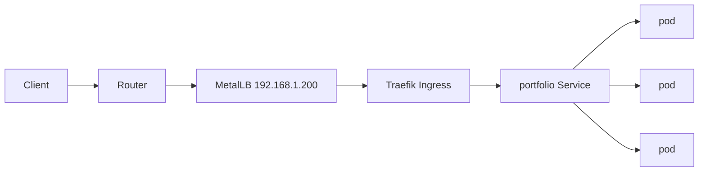

K3s bare metal is what I run instead of paying a per-hour control-plane fee on EKS, GKE, or AKS. One binary installs the control plane, containerd, flannel, Traefik, and the local-path provisioner. This is the setup, including how Ingress gets a real IP with MetalLB and where storage comes from.

## Why run it yourself

A managed control plane on EKS, GKE, or AKS costs about $100 a month before any worker node exists. On hardware you already own, K3s runs the same orchestrator for the price of electricity.

### The hardware

My cluster mixes Raspberry Pi 5s with recycled office desktops:

| Node | Hardware | Role | Specs |
|---|---|---|---|
| `k0-control` | HP EliteDesk 800 G4, recycled | Control plane and worker | i5-8500T, 32 GB RAM, 512 GB NVMe |
| `k1-worker` | Raspberry Pi 5 | Worker | 4 GB RAM, 128 GB SSD over USB 3.0 |
| `k2-worker` | Raspberry Pi 5 | Worker | 8 GB RAM, 256 GB SSD over USB 3.0 |
| `k3-worker` | Dell OptiPlex 3060, recycled | Worker | i5-8500T, 16 GB RAM, 256 GB NVMe |
| `k4-worker` | Lenovo ThinkCentre, recycled | Worker | i5-7500T, 16 GB RAM, 256 GB SATA SSD |

Total cost was about $300, mostly the Pi boards and SSDs. The desktops were e-waste.

## Why K3s

K3s is a CNCF-certified Kubernetes distribution built for small machines. It replaces etcd with SQLite or embedded PostgreSQL, drops legacy alpha features, and ships as a single binary of about 60 MB.

### Against a full distribution

| Feature | K3s | Standard Kubernetes |
|---|---|---|
| Binary size | ~60 MB | ~1 GB+ |
| RAM for the control plane | ~300 MB | ~1.5 GB |
| Database | SQLite by default | etcd |
| TLS | Generated automatically | Manual setup |
| Built in | Traefik, local-path provisioner, Helm | Nothing |
| Certificate management | cert-manager, optional | cert-manager, required |

## Installing

### The control plane

```bash
# On the control plane node (Ubuntu 24.04)
curl -sfL https://get.k3s.io | sh -s - \
  --write-kubeconfig-mode 644 \
  --disable traefik \
  --disable metrics-server

# Get the node token for workers
sudo cat /var/lib/rancher/k3s/server/node-token
```

### Workers

```bash
# On each Raspberry Pi or desktop
curl -sfL https://get.k3s.io | K3S_URL=https://k0-control:6443 \
  K3S_TOKEN="your-node-token" \
  sh -

# Verify from the control plane
kubectl get nodes
```

```
NAME          STATUS   ROLES                  AGE   VERSION
k0-control    Ready    control-plane,master   12m   v1.30.2+k3s2
k1-worker     Ready    <none>                 8m    v1.30.2+k3s2
k2-worker     Ready    <none>                 7m    v1.30.2+k3s2
k3-worker     Ready    <none>                 5m    v1.30.2+k3s2
k4-worker     Ready    <none>                 3m    v1.30.2+k3s2
```

## Networking

### Flannel

K3s uses Flannel over VXLAN by default, which works across subnets with no configuration:

```bash
# Check pod network
kubectl get pods -n kube-system
kubectl describe node k1-worker | grep PodCIDR
```

### MetalLB

Bare metal has no cloud load balancer. MetalLB assigns addresses from your LAN range to services of type `LoadBalancer`:

```bash
kubectl apply -f https://raw.githubusercontent.com/metallb/metallb/v0.14.5/config/manifests/metallb-native.yaml

# Configure IP pool
cat <<EOF | kubectl apply -f -
apiVersion: metallb.io/v1beta1
kind: IPAddressPool
metadata:
  name: lan-pool
  namespace: metallb-system
spec:
  addresses:
  - 192.168.1.200-192.168.1.220
---
apiVersion: metallb.io/v1beta1
kind: L2Advertisement
metadata:
  name: l2-advert
  namespace: metallb-system
EOF
```

## Storage

### Local path

K3s includes a local storage provisioner:

```yaml
apiVersion: v1
kind: PersistentVolumeClaim
metadata:
  name: postgres-data
spec:
  accessModes:
    - ReadWriteOnce
  storageClassName: local-path
  resources:
    requests:
      storage: 10Gi
```

### Longhorn

Longhorn replicates volumes across nodes:

```bash
kubectl apply -f https://raw.githubusercontent.com/longhorn/longhorn/v1.6.2/deploy/longhorn.yaml
```

## Workloads

### A web app

```yaml
apiVersion: apps/v1
kind: Deployment
metadata:
  name: portfolio
spec:
  replicas: 3
  selector:
    matchLabels:
      app: portfolio
  template:
    metadata:
      labels:
        app: portfolio
    spec:
      containers:
      - name: app
        image: ghcr.io/username/portfolio:latest
        ports:
        - containerPort: 3000
        resources:
          requests:
            memory: "128Mi"
            cpu: "100m"
          limits:
            memory: "512Mi"
            cpu: "500m"
---
apiVersion: v1
kind: Service
metadata:
  name: portfolio
spec:
  type: LoadBalancer
  ports:
  - port: 80
    targetPort: 3000
  selector:
    app: portfolio
```

A request to the portfolio takes this path:



### Mixed ARM and x86

Node affinity keeps a pod on the architectures its image supports:

```yaml
apiVersion: apps/v1
kind: Deployment
metadata:
  name: cross-platform
spec:
  replicas: 2
  template:
    spec:
      affinity:
        nodeAffinity:
          requiredDuringScheduling:
            nodeSelectorTerms:
            - matchExpressions:
              - key: kubernetes.io/arch
                operator: In
                values:
                - arm64
                - amd64
      containers:
      - name: app
        image: myimage:latest  # Must be multi-arch
```

## Observability

```bash
# Metrics Server (lightweight)
kubectl apply -f https://github.com/kubernetes-sigs/metrics-server/releases/latest/download/components.yaml

# K9s (terminal dashboard)
k9s

# cAdvisor + Prometheus + Grafana (via Helm)
helm repo add prometheus-community https://prometheus-community.github.io/helm-charts
helm upgrade --install kube-prometheus-stack prometheus-community/kube-prometheus-stack
```

## What runs on it

| Service | Purpose | Architecture |
|---|---|---|
| Adguard Home | DNS and ad blocking | ARM64 |
| Vaultwarden | Password manager | ARM64 |
| Gitea | Git hosting | AMD64 |
| Drone CI | CI pipeline | AMD64 |
| Nextcloud | File sync | AMD64 |
| Uptime Kuma | Monitoring | ARM64 |
| Nginx Proxy Manager | Reverse proxy | ARM64 |
| [PostgreSQL](/blog/replaced-my-entire-stack-with-postgres) and Redis | Stateful storage | AMD64 |

## Power

The cluster idles at about 73 W, which is roughly $15 a month:

| Device | Idle | Load |
|---|---|---|
| 2x Raspberry Pi 5 | 8 W | 15 W |
| 3x recycled desktops | 45 W | 120 W |
| Switch and accessories | 15 W | 15 W |
| USB fans | 5 W | 5 W |
| **Total** | **~73 W** | **~155 W** |

## What I learned

1. SD cards die. Boot every Raspberry Pi from a USB SSD.
2. ARM images are still uneven. Not every [Docker image](/blog/docker-for-frontend-developers) publishes `linux/arm64`.
3. Network reliability matters. A flaky switch produces node flapping that looks like a Kubernetes bug.
4. Upgrades are uneventful. `apt upgrade` then `systemctl restart k3s` has worked every time.
5. Mixed architectures are manageable. Build multi-arch images, and use affinity rather than emulation where you can.

## Summary

For learning Kubernetes on real workloads, a small bare-metal cluster is cheaper than a managed control plane and exposes the failure modes you will meet: disk wear, network flaps, and mixed architectures. About $300 in hardware and $15 a month runs ten services on nodes you can replace one at a time.

## K3s on bare metal, in questions

### What does K3s need from a bare-metal host?

A Linux host with swap disabled (or handled through the kubelet config), `/var/lib/kubelet`
on a disk you control, a unique hostname per node, and the control-plane and node ports open
between nodes. Containers are just processes on the kernel you own.

### Why K3s instead of kubeadm?

K3s ships the control plane, containerd, flannel, CoreDNS, Traefik, and a local-path
provisioner in one binary. There is no certificate bootstrap or etcd setup to run by hand,
which is the entire reason it fits a home or small-office cluster.

### How do Ingress and services get an IP without a cloud provider?

Install MetalLB and give it a free range on your LAN. Traefik's Service is type
`LoadBalancer`, so MetalLB assigns it an address and advertises it; your Ingresses are then
reachable at that IP.

### What about persistent storage on bare metal?

K3s bundles the local-path provisioner, which is fine on a single node. For volumes that
survive a node loss use Longhorn; if you already have a NAS, an NFS-backed CSI driver is
less to operate.

### How do I add another node?

Run the installer with `K3S_URL` and `K3S_TOKEN` pointing at the first server. The new node
registers as an agent, and the control plane stays on the servers.
