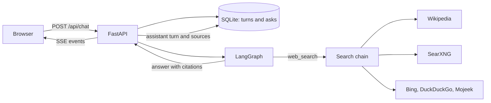

Askline was built from a deliberately narrow brief. It has one tool, web search, and one job: answer quickly from the web, cite what it used, and remember what was asked and when. Most chat agents grow by adding tools. This one was held to a single tool because the hard parts of a useful answer sit elsewhere.

A search result has to reach the model intact. A citation has to point at a page that was actually retrieved. The record of a question has to survive the session that produced it. Each requirement constrains the design more than adding another tool would, and the resulting system is smaller but less forgiving.

The implementation is a FastAPI service, a LangGraph state machine, a SQLite file, and a single-page interface. What follows is the set of decisions that made it work, including the ones that failed first.

## The shape of a turn

The browser posts a message and receives a stream. The server writes the user question to SQLite, recalls related questions, and starts the graph. The graph has three nodes. `agent` decides whether to search. The tool node calls the single `web_search` function. `collect` merges the results, removes duplicates by URL, and renumbers the source list.



The renumbering in `collect` is not cosmetic. The model sees numbered results and writes `[n]` markers. If a later search appends results without renumbering, the model can cite a number that means something different to the browser. Keeping one numbering from the tool result to the stored source is what makes a citation checkable.

The loop stops after two search rounds. At the cap, the model is bound without tools, which forces an answer rather than a third search. This is a latency decision as much as a correctness one. An agent that can always search again will often search again, and each round adds a model call to a conversation that already includes one.

## Citations are a data problem

The common failure in a search agent is not that the model invents a URL. It is that the model cites a number the user cannot resolve. Askline addresses that at the boundary rather than in the prompt alone.

Every result set is numbered. The prompt requires `[n]` markers that map to those numbers. Before the answer is stored, citations outside the retrieved range are removed, and the source list is persisted with the turn. A page that was never retrieved cannot appear as a source, and a citation that survives the check points at a page the model actually received.

This matters because a citation is a claim about provenance, not decoration. If the answer says `[3]` and source 3 is a page the search never returned, the interface has manufactured evidence. The filter is small, but it changes what the interface can assert.

The model does not always respect the tool protocol. During testing, LFM3 returned a second-round tool call as literal text, `<tool_call><function=web_search>...`, instead of a structured call. The stream had already sent that markup to the browser, so the answer appeared as raw XML. The fix was to hold back any text that could be the prefix of a tool-call block, drop complete blocks, and recover a text-form call when it names `web_search`. This is a guard at a known boundary, not a general parser for every malformed output.

## Memory is a log, not a summary

The memory feature could have been a model-written summary of the conversation. That approach fails a simple test: the summary is generated once, and later questions cannot tell which part of it is still true. Askline stores the transcript instead.

Two tables carry the feature. `turns` is the append-only record. `asks` is an FTS5 index over the user half, written in the same transaction as the turn, so the transcript and the recall index cannot disagree. Ordering uses the SQLite `rowid`, which keeps two questions from the same second in a predictable order.

Recall merges two sets. The last six questions are always included, because a history question often shares no words with the question it asks about. The remaining entries come from an FTS5 match on the current wording, with stop words removed and Porter stemming applied. The merged list is capped at 1,600 characters and formatted with a local time for each question.

```
MEMORY (the user's earlier questions, with local time)
- 2026-11-10 19:03 (today) Compare Postgres logical and physical replication
- 2026-11-10 19:01 (today) What changed in the latest Python release?
- 2026-11-03 09:12 (7 days ago) cheap flights to Lisbon in March
```

The time zone comes from the browser with each request, because a container's clock is UTC even when the person using it is not. Without that value the model reported a 19:04 question as 13:04. The first attempted fix failed for a second reason: Chromium reports the legacy alias `Asia/Calcutta`, and the slim Python image did not carry that zone file. Adding the `tzdata` package resolved the alias without special-casing it.

A vector store was considered and rejected. The corpus is one person's questions, the vocabulary is narrow, and FTS5 lives in the same file as the log. If recall quality becomes the limiting factor, one method, `Store.recall`, is the place to change. That is a smaller surface than introducing an embedding pipeline for a corpus that fits in a text file.

## Search is a chain, not a call

SearXNG is the primary general backend. It aggregates engines server-side and returns JSON, so the app makes one local request and receives a ranked list. If the instance is down, returns an error, or returns nothing relevant, the same search call falls through to public result pages.

Wikipedia leads for reference questions because its API is stable and its extracts carry the figures a reference answer needs. The ordering is deliberate. A question about the latest release wants a current page, so Wikipedia goes last. A question about a historical rate wants a table, so Wikipedia goes first.

The fallback chain has a relevance filter. Bing answered "latest LangGraph release" with unrelated television news because the word "latest" alone was enough for a match. A result now has to share a distinctive word with the query, and a backend whose results are all filtered reports that fact so the next backend can try. The filter is crude, but it prevents a bad result set from becoming the model's entire evidence.

The Wikipedia path failed on the first attempt with an HTTP 403. Wikimedia rejects the browser user agent the scraped parsers use, so the API calls send a project-specific agent. That detail is the kind of thing that looks like a bug in the parser until the response code is read.

Dashboards exposed a gap that search alone could not close. "Create a dashboard on the voter turn out of the USA" returned advice about where to find data, not the data. The delegated results had missed the reference page, and the prose contained no year series. The fix had two parts. The query is normalized from "voter turn out of the USA" to "voter turnout of the United States", and a table reader looks for the first table with a year column and a percentage column, rejecting a page whose title names a different country.

On the deployed app, that turn produced a line chart with 24 presidential elections from 1932 to 2024, read from the Wikipedia turnout table. The prose above the chart still repeated a 51 to 52 percent range while the chart showed roughly 49 to 63 percent. The chart was correct and the prose was not. That is a model-quality failure, not a retrieval failure, and it is worth stating plainly because a generated chart can make a wrong sentence look authoritative.

## The answer has two layers

Every turn has two switches, and both start on. Delegate hands the research to a tree of subagents. Visual adds a small generated interface below the prose.

The subagent tree has a depth cap of three and a budget of seven nodes. A planner turns the question into one to three briefs, each assigned the role `research`, `design`, or `critic`. A research node searches, writes findings, and may request up to two follow-up nodes. Design and critique nodes work from the parent findings. The root model writes one cited answer from the collected findings, and the task tree streams to the browser while it runs.

Follow-up questions resolve against the thread before planning begins. A short model call rewrites "can you showcase me metrics" into a standalone search question using the earlier turns. Without that step, the planner receives a sentence whose subject exists only in the previous message.

The visual layer is OpenUI rendered with the shadcn design system. The model does not write OpenUI Lang directly. LFM3 1.7B cannot hold the language specification reliably; attempts produced raw markup, repeated roots, and truncated programs. The server asks for a small JSON object, enforces its shape with llama.cpp's JSON schema, and composes the program from that object. The model still chooses the title, the answer, the facts, and the follow-up questions. The layout follows the question: a comparison gets a table, and other questions get a numbered list.

This division matters because it keeps the interface derived from the answer rather than generated beside it. The card does not introduce sources of its own. In the chat, source chips come from the same numbered results the answer cites. A presentation layer that invents its own evidence would recreate the problem the citation filter exists to prevent.

## The runtime changed the latency

The first deployment ran Ollama on an RTX 3070 laptop GPU. It reported 100 percent GPU use and generated 3.7 tokens per second. NVML showed the GPU at 210 MHz and 13 W, which is an idle state, not a working one.

The same GPU with llama.cpp `server-cuda` generated 165 tokens per second for a 120-token completion, at 1785 MHz and 56 W. The engine was the bottleneck, not the hardware. The stack moved to llama.cpp and kept the raw device passthrough that the server already supported: the NVIDIA devices plus the driver libraries from `/opt/nvidia-libs`, without a CDI specification.

LFM3 introduced a second latency problem. It emits reasoning tokens before content, and on structured tasks it could consume the whole token budget without producing an answer. At the two-search cap this surfaced as an empty response. The server supports `chat_template_kwargs: {"enable_thinking": false}`, which returns a complete answer in a fraction of the time for card composition and prompt generation. Ordinary chat keeps reasoning on, because the prose benefits from it.

The measured turn on the deployment host looks like this.

| Stage | Time |
| --- | --- |
| SSE headers and `meta` | 0.02 s |
| Model decides to call the tool | 1.7 s |
| Search results, cached | 1.7 s |
| First visible token | 8.6 s |
| Turn complete | 9.9 s |
| Generation rate | 134 tok/s |

Most of the wait is the reasoning phase before the first visible token. Once the answer begins, it arrives quickly. This is why the interface streams status events before it streams text. A blank screen for eight seconds reads as a failure even when the system is working.

## Deployment is one command

The compose stack has three services: llama.cpp with the bundled GGUF, SearXNG, and the app. `run.sh` detects the compose provider, detects the GPU and its driver libraries, applies the GPU override when both exist, waits for the model, and waits for the health endpoint.

The fresh deployment path is a clone and one command.

```sh
git clone https://github.com/DeathSurfing/askline.git /opt/askline
cd /opt/askline && cp .env.example .env && ./run.sh up
```

The model downloads once into a volume. Later starts reuse it. On a host without a GPU, the same command runs on the CPU, which is slower but does not require a second configuration.

Verification is split between tests and the real artifact. The suite replaces the chat model with a scripted `BaseChatModel` and gives the search engine an `httpx.MockTransport`, so routing, the search cap, source merging, citation filtering, SSE framing, persistence, caching, settings, chart extraction, and the memory block are exercised without a network. The current suite has 84 tests.

What the suite cannot prove is that a real model will use the protocol. That requires a browser, a real search, and a question whose answer can be checked against its source. The dashboard turn, the Python release question, and the memory question were each run through the deployed interface for that reason.

## What the constraint changed

A single tool did not make the agent simple. It made the failure modes legible. With one retrieval path, every answer depends on the same three properties: the result set must be numbered, the citation must survive the boundary, and the question must be stored with a time. Adding tools would have added capability without addressing any of them.

The limits are equally clear. The app has no authentication and assumes one person's history per database. The scraped search fallbacks are best-effort and will need attention when a page changes. A 1.7B model can write a sentence that contradicts the chart it is showing. The system can catch a citation outside the retrieved range, but it cannot make a small model reason well.

The decisions that carry over are the structural ones. Number sources where they enter the system, and keep that numbering until they are stored. Write the question and its timestamp in the same transaction as the transcript, so recall cannot drift from the record. Derive an interface from a schema when the model cannot be trusted with the interface language. These are not features of Askline. They are the parts that would survive replacing its model, its search backend, or its frontend.
