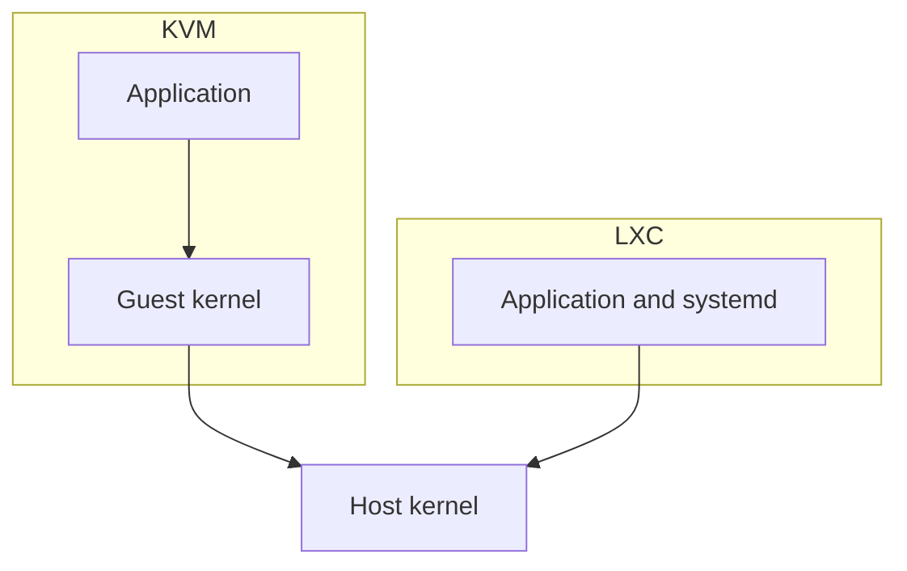

Proxmox LXC is the container runtime built into Proxmox VE. It starts a full operating system, not a single process, so a container behaves like a very small VM while sharing the host kernel. This is what LXC is, how it differs from Docker and from OpenVZ, and the parts that actually trip people up in production.

## VMs and containers on Proxmox

Proxmox VE runs both full VMs on KVM and system containers on LXC. A VM virtualises the hardware and boots its own kernel. A container shares the host kernel, so it carries no second kernel and no emulated devices.



### Density

| Metric | KVM VM | LXC container |
|---|---|---|
| Boot time | 30-60s | `<1s` |
| RAM overhead | ~300 MB per VM | ~10 MB per container |
| Disk usage | 2-10 GB base | ~200 MB base |
| Max density per host | 10-20 | 100+ |
| Kernel isolation | Full, separate kernel | Shared, host kernel |

## LXC compared with Docker

[Docker containers](/blog/docker-for-frontend-developers) run a single process and are rebuilt from an image, which makes them disposable by design. LXC containers are system containers: they run `systemd`, own a persistent filesystem, and are reached over SSH.

| Feature | Docker | LXC on Proxmox |
|---|---|---|
| Scope | Single process | Full OS |
| Persistence | Volumes | Native filesystem |
| Networking | Overlay or bridge | Bridge, NAT, routed |
| Management | Docker CLI and compose | Proxmox UI and `pct` |
| Use case | Stateless services | Infrastructure services |

## Creating a container

In the Proxmox web UI:

- Open Datacenter, then the node, then Create CT.
- Select a template from Ubuntu 24.04, Debian 12, or Alpine.
- Allocate CPU cores, RAM, and disk.
- Configure networking, either DHCP or static.

Or from the shell:

```bash
# List available templates
pveam available

# Download an Ubuntu template
pveam download local ubuntu-24.04-standard_24.04-2_amd64.tar.zst

# Create the container
pct create 100 \
  local:vztmpl/ubuntu-24.04-standard_24.04-2_amd64.tar.zst \
  --rootfs local-lvm:8 \
  --cores 2 \
  --memory 2048 \
  --net0 name=eth0,bridge=vmbr0,ip=dhcp \
  --hostname my-ct

# Start it
pct start 100

# Enter the shell
pct enter 100
```

### After creation

```bash
# Set root password
pct set 100 --password

# Assign a static IP
pct set 100 --net0 name=eth0,bridge=vmbr0,ip=192.168.1.100/24,gw=192.168.1.1

# Mount a bind mount from the host
pct set 100 --mp0 /storage/data,mp=/mnt/data

# Set resource limits
pct set 100 --memory 4096 --swap 1024 --cores 4
```

## A production layout

```
┌──────────────────────────────────────┐
│         Proxmox Host (Debian)        │
│  ┌────────┐ ┌────────┐ ┌──────────┐ │
│  │ LXC 101 │ │ LXC 102 │ │ LXC 103  │ │
│  │  DNS    │ │  DB     │ │  Web     │ │
│  │ (PiHole)│ │(Postgres│ │ (Nginx + │ │
│  │         │ │ + Redis)│ │  Next.js)│ │
│  └────────┘ └────────┘ └──────────┘ │
│  ┌────────┐ ┌────────┐ ┌──────────┐ │
│  │ LXC 104 │ │ LXC 105 │ │ LXC 106  │ │
│  │  VPN    │ │  CI/CD  │ │  Backup  │ │
│  │ (WG)   │ │ (Drone) │ │ (Borg)   │ │
│  └────────┘ └────────┘ └──────────┘ │
└──────────────────────────────────────┘
```

One service per container is the point of the layout. A failed upgrade in the web container does not touch DNS or the database.

## Networking

### Bridge

Containers get addresses on the same subnet as the host, so the rest of the LAN reaches them directly.

```bash
# /etc/network/interfaces on the Proxmox host
auto vmbr0
iface vmbr0 inet static
  address 192.168.1.10/24
  gateway 192.168.1.1
  bridge-ports eno1
  bridge-stp off
  bridge-fd 0
```

### NAT

Containers share the host's address through NAT, which helps when public addresses are scarce.

```bash
pct set 100 --net0 name=eth0,bridge=vmbr0,firewall=1
# Set up NAT via iptables on the host
```

## Snapshots and backups

```bash
# Snapshot, including RAM
pct snapshot 100 pre-upgrade --description "Before Postgres 16 upgrade"

# Backup to Proxmox Backup Server
vzdump 100 --compress zstd --mode snapshot --storage pbs

# Restore
pct restore 100 /var/lib/vz/dump/vzdump-lxc-100-2026_07_02.tar.zst
```

## Memory and disk

### Memory

A container adds no kernel of its own, so its memory use is the processes inside it. A small Alpine container running one service uses about 15 MB.

```bash
# Limit memory hard and soft
pct set 100 --memory 2048 --swap 512

# View actual memory usage
pct status 100 --verbose
```

### Disk

Use `.raw` images on ZFS or LVM-thin, which snapshot cheaply.

```bash
# Move rootfs to a different storage
pct move-volume 100 rootfs local-zfs

# Resize rootfs online
pct resize 100 rootfs +4G
```

## LXC or KVM

| Scenario | Best fit |
|---|---|
| Web servers, databases | LXC |
| A Docker host | LXC, with Docker inside |
| Custom kernels or kernel modules | KVM |
| Windows guests | KVM |
| Untrusted workloads | KVM |
| Maximum density | LXC |
| Snapshots with RAM | LXC |

## Summary

LXC gives you container density with VM-like management. For Linux services such as web servers, databases, DNS, and monitoring, it is the default on Proxmox. Reach for KVM when you need a different kernel, a Windows guest, or isolation from code you do not trust.

## Proxmox LXC questions I get most

### Is Proxmox LXC the same as Docker?

No. LXC containers are **system containers**: they run `systemd`, own a persistent
filesystem, and are reached over SSH like a machine. Docker containers are single-process
and rebuilt from an image, which is why they are disposable by design.

### LXC vs OpenVZ?

OpenVZ required a patched host kernel. Proxmox VE moved to LXC, which uses the mainline
kernel's cgroup and namespace primitives, and dropped OpenVZ entirely in the 4.x line.
Everything current is LXC.

### How do I run Pihole, Scrypted, or an *arr stack as a container?

Use the community-scripts (previously tteck) helpers from the Proxmox shell. Each script
creates an unprivileged container, installs the app, and writes its own update cron. One
container per app beats one shared Docker host for exactly this kind of service.

### Where do the keyctl and nesting feature flags go?

In `/etc/pve/lxc/<vmid>.conf`, under `features:`. `keyctl=1` is needed by software that
uses the kernel keyring; `nesting=1` is needed by anything that runs a container runtime
inside the container. Both are toggles in the container's Options tab.

### How do I move a container's disk to another storage?

`pct move-volume <vmid> <volume> --target-storage <storage>`, or Resources, then Move
Volume in the UI. Stop the container first so the copy is consistent.

### Which template should I start from?

`pveam available` lists them. The Ubuntu 24.04 standard template
(`ubuntu-24.04-standard_24.04-2_amd64.tar.zst`) or the Debian 12 equivalent covers almost
everything.
