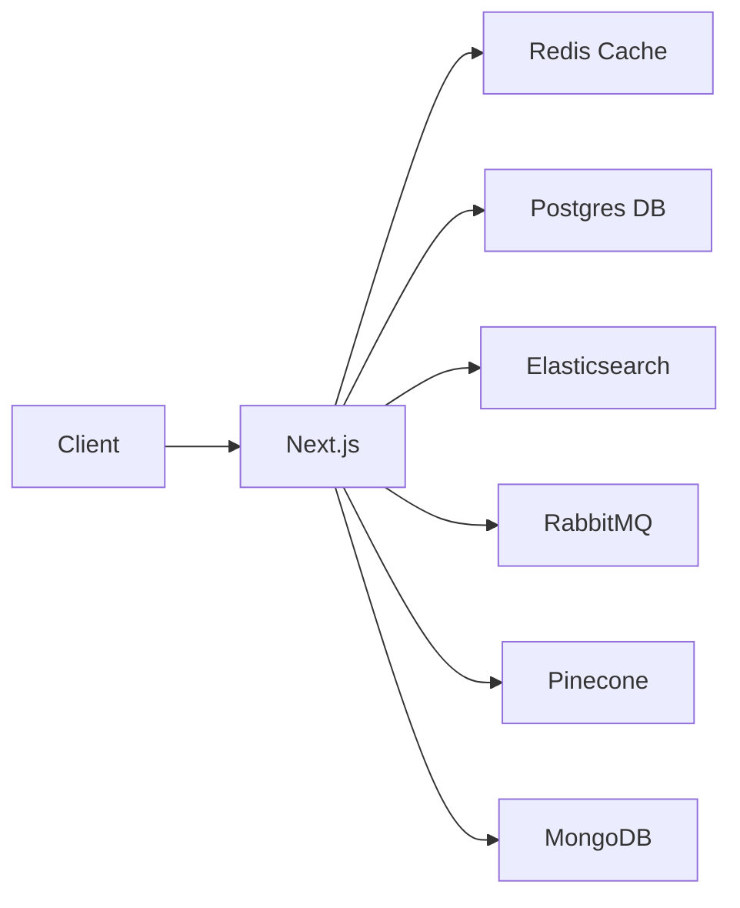

I replaced my entire stack with Postgres. Queues, cache, document store, embeddings, scheduled jobs, and search all run in the same database, which removed four services and their backup stories. Here is what Postgres actually absorbs, and the parts where it is still the wrong tool.

## What Postgres absorbs

Postgres is a relational database with an extension system. Extensions add vector search, queues, scheduling, columnar storage, and geospatial types inside the same server, so one process, one backup, and one set of credentials covers all of it.

The stack it replaces is Postgres plus Redis, MongoDB, Elasticsearch, RabbitMQ, and a vector database, each with its own backup and monitoring.

## Extensions

### pgvector: vector search

Semantic search, RAG embeddings, and recommendations without a separate vector database:

```sql
CREATE EXTENSION vector;

CREATE TABLE documents (
  id SERIAL PRIMARY KEY,
  content TEXT,
  embedding VECTOR(1536)  -- OpenAI embedding dimension
);

-- Search by semantic similarity
SELECT content, 1 - (embedding <=> '[0.01, -0.02, ...]') AS similarity
FROM documents
ORDER BY embedding <=> '[0.01, -0.02, ...]'
LIMIT 5;

-- With an IVFFlat index for speed
CREATE INDEX ON documents USING ivfflat (embedding vector_cosine_ops)
  WITH (lists = 100);
```

It replaces Pinecone, Weaviate, Qdrant, and Milvus.

### pg_cron: scheduled jobs

Jobs run inside Postgres, with no external cron daemon:

```sql
CREATE EXTENSION pg_cron;

-- Vacuum every night
SELECT cron.schedule('nightly-vacuum', '0 3 * * *',
  'VACUUM ANALYZE');

-- Clean up expired sessions every hour
SELECT cron.schedule('cleanup-sessions', '0 * * * *',
  $$DELETE FROM sessions WHERE expires_at < NOW()$$);

-- Send digest emails daily
SELECT cron.schedule('daily-digest', '0 8 * * *',
  $$SELECT send_digest_emails()$$);
```

It replaces cron, Sidekiq, Celery beat, and AWS EventBridge.

### pg_later: asynchronous queries

Submit a query and collect the result later:

```sql
SELECT pg_later.submit($$REFRESH MATERIALIZED VIEW analytics_mv$$);
SELECT pg_later.submit(
  $$UPDATE users SET reputation = compute_reputation(id) WHERE id = $1$$,
  ARRAY['123e4567']
);
```

It replaces a background job queue such as Celery or BullMQ.

### pgmq: message queues

A message queue inside Postgres:

```sql
CREATE EXTENSION pgmq;

-- Create a queue
SELECT pgmq.create('email_queue');

-- Send messages
SELECT pgmq.send('email_queue',
  '{"to": "user@example.com", "subject": "Welcome!"}');

-- Receive (with visibility timeout)
SELECT pgmq.read('email_queue', 60, 5);

-- Delete after processing
SELECT pgmq.delete('email_queue', msg_id);

-- Archive for audit
SELECT pgmq.archive('email_queue', msg_id);
```

It replaces RabbitMQ, Redis pub/sub, SQS, and NATS.

### pg_analytics: columnar storage

Analytics queries over Postgres data in columnar format:

```sql
CREATE EXTENSION pg_analytics;

-- Convert a table to columnar format
ALTER TABLE events SET ACCESS METHOD columnar;

-- Run OLAP queries at columnar speed
SELECT DATE_TRUNC('day', created_at), COUNT(*), AVG(revenue)
FROM events
GROUP BY 1
ORDER BY 1 DESC;
```

It replaces ClickHouse, Snowflake, and Redshift for many workloads.

### PostGIS: geospatial

Spatial types, indexes, and distance functions:

```sql
CREATE EXTENSION postgis;

SELECT name, ST_Distance(
  location,
  ST_SetSRID(ST_MakePoint(-73.985, 40.748), 4326)
) AS distance
FROM landmarks
ORDER BY location <-> ST_SetSRID(ST_MakePoint(-73.985, 40.748), 4326)
LIMIT 10;
```

It replaces MongoDB GeoJSON, Elasticsearch Geo, and a dedicated GIS server.

### hstore and JSONB: documents

Flexible schemas alongside relational data:

```sql
CREATE TABLE products (
  id SERIAL PRIMARY KEY,
  name TEXT NOT NULL,
  attributes JSONB,
  metadata HSTORE
);

-- Index any JSON path
CREATE INDEX ON products USING GIN (attributes jsonb_path_ops);

-- Query deep into documents
SELECT * FROM products
WHERE attributes @> '{"category": "electronics", "specs": {"wifi": "6E"}}';
```

It replaces MongoDB, Firebase, and DynamoDB for document workloads.

## Before and after

### The stack before



Six infrastructure services to manage, back up, monitor, and scale.

### The stack after


One database, one backup, one dashboard.

## What replaces what

| Service | Extensions | Protocol |
|---|---|---|
| MongoDB | `jsonb`, `btree_gin` | Native JSON with GIN indexes |
| Redis cache | `pg_bm25`, `pg_lru` | Built-in caching and BM25 search |
| Redis pub/sub | `pgmq`, `LISTEN/NOTIFY` | Message queue and event notifications |
| RabbitMQ | `pgmq` | Persistent, SQL-managed queues |
| Elasticsearch | `pgvector`, `pg_bm25` | Full-text and vector search |
| Pinecone | `pgvector` | Vector similarity with IVFFlat or HNSW |
| Sidekiq or Celery | `pg_cron`, `pg_later` | Scheduled and background queries |
| ClickHouse | `pg_analytics` | Columnar storage for OLAP |
| Neo4j | `age` | Graph queries with Apache AGE |
| Firebase | `jsonb` and PostgREST | REST API from Postgres schemas |

## When to consolidate

- A small team carries less operational work with fewer services.
- Features need transactions that span tables.
- You can tolerate the latency of one process instead of a dedicated cache.
- You want one image to deploy rather than six.
- It is a startup or a side project, where extraction can happen later.

### When to keep them separate

- Queue throughput exceeds what Postgres can sustain. Above roughly 10k messages per second, RabbitMQ is the better tool.
- A cache needs sub-millisecond reads. Redis is still faster for hot keys.
- Full-text search has to scale further than `pg_bm25` takes it.
- Compliance requires isolation between services.

## The cluster I run

On my K3s cluster, one Postgres container with these extensions runs all of this:

```yaml
# postgres.yaml
apiVersion: apps/v1
kind: StatefulSet
metadata:
  name: postgres
spec:
  template:
    spec:
      containers:
      - name: postgres
        image: pgvector/pgvector:pg17
        env:
        - name: POSTGRES_EXTENSIONS
          value: "vector,pg_cron,pgmq,postgis,hstore,pg_analytics"
```

It runs in a single 4 GB LXC container and holds:

- the primary application database
- the full-text search index, through GIN and `pg_bm25`
- the vector store for embeddings
- the background job queue, through `pgmq`
- the scheduled task runner, through `pg_cron`
- the analytics store, columnar through `pg_analytics`
- the cache layer, through materialised views and `LISTEN`/`NOTIFY`

## Where it breaks

- Postgres replication is single-primary, so high concurrency needs a connection pooler such as PgBouncer in front.
- Extensions install per database, not per server.
- Managed Postgres on RDS or Cloud SQL does not offer every extension.
- Write throughput on a single node tops out around 50k to 100k writes per second.

## Summary

Extensions turn Postgres into a general data store: queue, cache, document store, search index, vector store, and scheduler. For most applications, especially startups and internal tools, that is one service instead of six. Fewer services means fewer failure points and less time spent on backups and upgrades.

## Replacing a stack with Postgres, in questions

### What can Postgres actually replace?

A job queue (`SELECT ... FOR UPDATE SKIP LOCKED` plus `LISTEN`/`NOTIFY`), a cache
(unlogged tables), a document store (JSONB with a GIN index), a vector store (pgvector), a
scheduler (pg_cron), and full-text search (`tsvector` with a GIN index).

### Is Stack Builder necessary for PostgreSQL?

No. Stack Builder is an EDB add-on in the Windows installer that fetches extra drivers and
tools. The server runs without it, and on Linux or macOS you install extensions from your
package manager instead.

### Which extensions are worth installing first?

pgvector for embeddings, pg_cron for scheduled work, pg_trgm for fuzzy matching. Key
generation needs nothing extra: `gen_random_uuid()` is built in.

### Why does Postgres reject concat_ws in an index?

`concat_ws` is marked STABLE, not IMMUTABLE, in `pg_proc`, because the result depends on
type output functions. An index expression or a CHECK constraint must be immutable, so
Postgres refuses it. Persist the value into a column, or use `||` concatenation.

### Does this hold on a managed host like Stackit?

The engine is the same, so the answer depends on which extensions the host allows. Check
the extension list before designing around pgvector or pg_cron.

### When is Postgres still the wrong answer?

Large analytical scans, multi-region write scaling, and big binary objects. A warehouse, a
distributed SQL database, and object storage are better at those. Treat the claim as a
default, not a rule.
