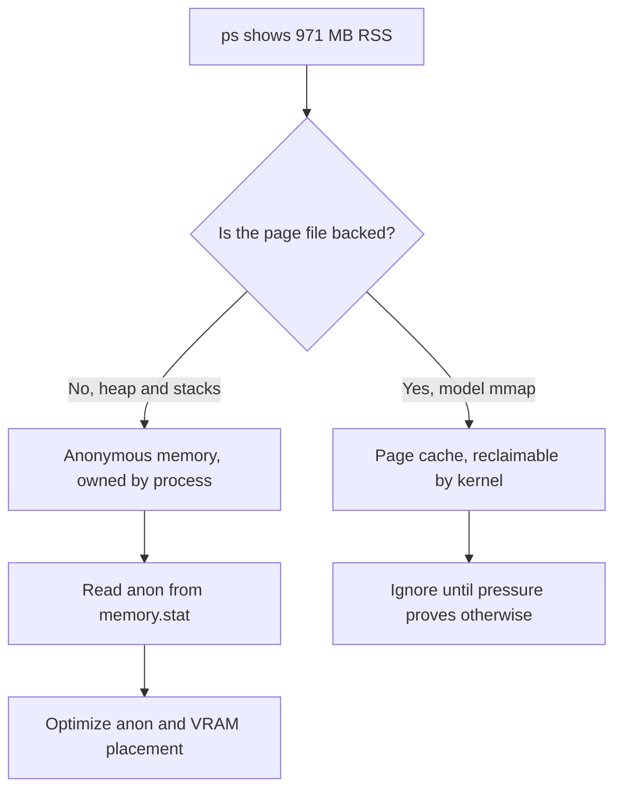
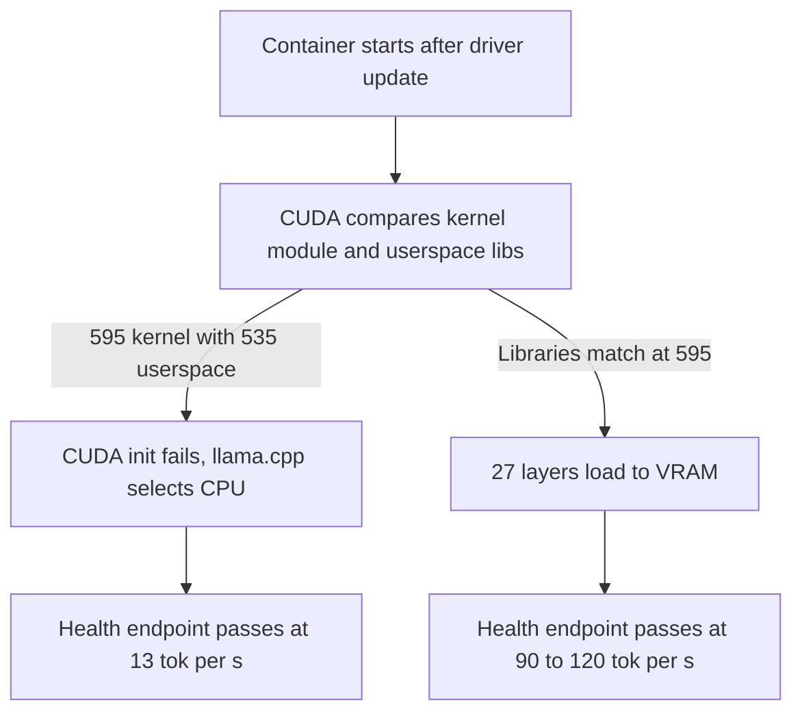

I check `free -m` after every deploy. The host has 15.4 GB of memory and usually reports more than 13 GB available, so the check is not driven by scarcity. A stack that fits in a smaller box is easier to move and less likely to fail when something else runs beside it. That is the reason for the habit.

The Siela stack contains Postgres, Valkey, a Bun commander, a router, two voice workers, a TTS service, watchtower, and a local llama.cpp server for Delulu. Before this work it used about 1.4 GB of anonymous memory with the language model on CPU. It now uses 459 MB, with the model in VRAM and generating about eight times faster.

The reduction did not come from one change. It came from a sequence of measurements, and several of those measurements were initially read incorrectly.

## Why RSS misleads

The first correction concerned what to measure. The llama.cpp process reported 971 MB of RSS and looked like the natural starting point. Its anonymous memory was 213 MB. The remainder was the model file mapped into the process, which the kernel counts as page cache. Under pressure the kernel can drop that cache and read it again. Calling it used memory is technically accurate and practically misleading.

`podman stats` did not resolve the question. It is broken on this host and fails while trying to stat a network namespace. I therefore read the per-container memory accounting directly from cgroupfs and looked at the `anon` line, which records memory the process owns. File-backed pages are a cache, not a lease.

```bash
# What the host reports after a deploy
free -m

# What each container owns, read per container
# libpod-*.scope matches the container scope name
cat /sys/fs/cgroup/machine.slice/libpod-*.scope/memory.stat | grep -E "^(anon|file)"
```

This distinction changes what gets optimized. Chasing RSS leads toward a smaller model or toward disabling mmap, either of which can make the result worse. Chasing anonymous memory and VRAM produces a sharper question. What is resident, and what can the kernel reclaim without work.



## Moving the model to VRAM

The largest saving came from placing the model on the GPU. The host has an RTX 3070 Laptop with 8 GB of VRAM, and llama.cpp can place all 27 layers there. That move reduced system memory held by the language model from over a gigabyte to about 213 MB. Generation rose from 13 tokens per second to between 90 and 120.

The first attempt failed in a way the configuration could not show. The host ran NVIDIA driver 535, which limits CUDA to 12.4, while current llama.cpp images require CUDA 12.8. I pinned an older CUDA 12.4 image and the stack worked. Later the driver moved to 595 and I removed the pin. The container started, reported healthy, and served requests. It had also returned to CPU.

The cause was version skew between kernel and userspace components. The kernel module was 595. The userspace libraries in `/opt/nvidia-libs` were still 535. CUDA reported an unsupported driver combination, selected the CPU, and continued. Nothing in the Compose file was wrong. The evidence was in the server log and in the generation speed.

```bash
# The log line that mattered more than the health endpoint
# cuda error: unsupported display driver / cuda driver combination
# falling back to CPU

nvidia-smi --query-gpu=driver_version,memory.used,memory.total --format=csv
llama-server --verbose 2>&1 | grep -i -E "cuda|layer|offload"
```

I copied the 595 libraries from the Proxmox host into the container library directory, kept the old set as a backup, and restarted. All 27 layers moved to VRAM. A memory optimization is therefore only established when the placement is verified. The health endpoint reported that the server was fine. It was fine. It was doing the wrong work slowly.



## Services that cost almost nothing at idle

The second largest saving came from a service that is usually not running. The TTS engine loads its model only when speech is requested and unloads it when no session uses it. At idle it holds about 1 MB. While speaking it can reach roughly 105 MB, then it returns to idle. Some work was required to keep the ONNX Runtime environment stable across reloads. The result is a service that costs almost nothing until there is a reason for it to exist.

The third saving came from a default. The llama.cpp server opened four parallel slots. Delulu is an occasional command, not a queue, so three of those slots held capacity that no traffic used. All four slots still required host buffers. Reducing the server to one slot lowered anonymous memory from 293 MB to 212 MB, with generation speed unchanged within measurement noise.

```yaml
# llama.cpp service, reduced to observed demand
command:
  - --parallel 1
  - --cache-ram 0
  - --n-gpu-layers 27
```

Defaults are where memory accumulates. Batch size and the prompt cache both looked like suspects. Reducing the batch changed nothing. The prompt cache changed something, but not in the expected direction.

## An 8 GB default nobody requested

The server keeps prompt states in host RAM and calls the result a cache. The default ceiling is 8192 MiB. That is not the GPU KV cache, which had already been quantized and moved to VRAM. It is a second cache in system memory with an eight gigabyte limit.

Delulu prompts are unique per call, so the cache mostly accumulates entries that are never reused. During testing, anonymous memory grew about 10 MB across six requests. Across days, that pattern is a slow increase with a very large ceiling. The container has a 2 GB limit, so the practical outcome is not an 8 GB allocation. It is an OOM kill after the cache fills the limit.

I disabled it with `--cache-ram 0`. The immediate saving was 13 MB. The more durable result is that the process no longer has a path to grow without bound.

## What I left unchanged

The remaining ideas did not justify their cost.

Smaller batches produced no measurable change. Disabling CUDA pinned buffers produced no measurable change. Running the router under `bun --smol` saved 2 MB, which is within noise. The bot could probably save a similar amount with the same flag, but that requires a production restart to confirm, and a restart is a worse trade than the number suggests.

```bash
# Ideas that measured at or near zero
# - smaller batch sizes: no change in anon
# - disabled CUDA pinned buffers: no change in anon
# - bun --smol on router: about 2 MB, within noise
```

Two larger tradeoffs were also rejected. Removing one voice worker would save 52 MB, but it would reduce the fleet from three concurrent streams to two because the commander also serves as a node. Removing watchtower would save 13 MB and remove automatic deploys. Both changes are reversible, and both make the product worse for a saving that is negligible on a 15 GB host.

For perspective, the Immich stack on the same machine uses about 820 MB of anonymous memory, more than this entire bot stack. I left it alone. The scope of this work was the bot compose stack, not the largest number on the host.

## Final measurement

The stack now stands as follows.

| Service | Anonymous memory |
| --- | ---: |
| llama.cpp | 213 MB |
| bot | 82 MB |
| voice-1 | 52 MB |
| voice-2 | 52 MB |
| router | 24 MB |
| postgres | 18 MB |
| watchtower | 13 MB |
| valkey | 2 MB |
| tts | 1 MB |
| **Total** | **459 MB** |

The language model also holds about 2 GB of VRAM out of 8 GB. The host reports 1.6 GB used and 13.8 GB available, with no swap in use. The roughly 9 GB in `buff/cache` is mostly model pages, and the kernel will return that memory when another process asks for it.

Attention to memory is useful up to a point. It forces a precise account of what each process holds and why. Past that point it becomes a demand for smaller numbers without a corresponding user-visible problem. The first gigabyte here required attention and a driver fix. The next fifty megabytes would have required removing a feature. I will keep checking `free -m` after deploys. The goal is enough headroom for the next service, not the smallest number possible.
