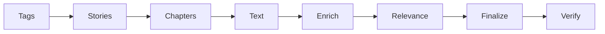
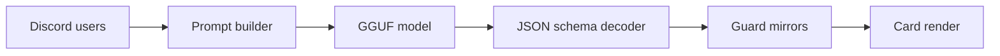
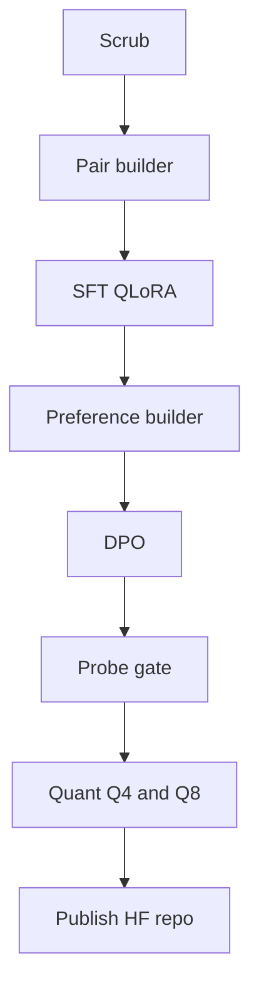
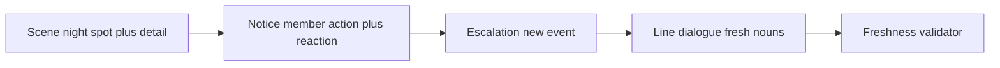
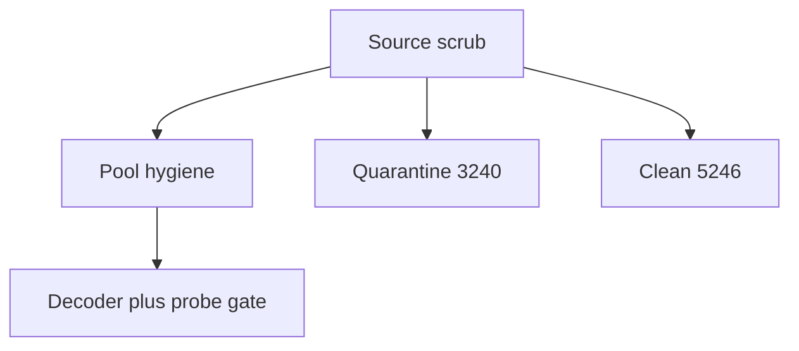
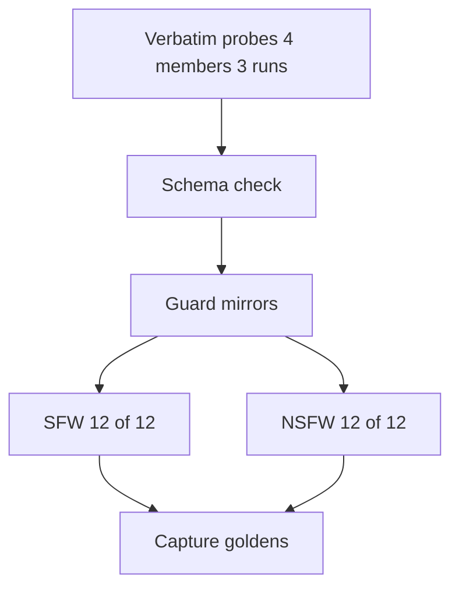

`tinyTanLLM-delulu-gemma` is a short-form comedic BTS scenario generator built for a Discord `/delulu` command. It produces strict JSON with four keys, `scene`, `notice`, `escalation`, and `line`, under a `json_schema` constrained decoder at temperature 0.7 and a maximum of 150 tokens.

The model starts from `IlyaGusev/gemma-2-2b-it-abliterated`, a refusal-abliterated Gemma 2 2B. It was trained with QLoRA SFT at rank 32 on 1,200 curated pairs, then DPO on 1,200 triplets. SFT reached an eval loss of 0.26. DPO reached an accuracy of 1.0, with the margin improving from 9.8 to 14.8. The release gate required 12 of 12 SFW probes and 12 of 12 NSFW probes to pass across 4 members and 3 runs each, with zero minors-coded language. The released artifacts are SFT and DPO LoRA adapters with `Q4_K_M` and `Q8_0` GGUF quantizations in the [Hugging Face repository](https://huggingface.co/DeathSurfing/tinyTanLLM-delulu-gemma).

## 1. The opportunity

A narrow task lets a small model succeed where a general model cannot. The bot needed a specific voice, a strict output contract, a hard memory ceiling, and safety boundaries that hold under pressure.

1. The voice is reader as protagonist with the member as initiator, in two registers: playful SFW and consensual adult.
2. Every reply must parse as JSON with four fresh keys, because Discord renders each key into its own card.
3. Training must fit on a single 16 GB card, an RTX 4080 SUPER, while inference must run on CPU on a small VPS or laptop. Anything needing 8 GB or more at runtime was excluded.
4. All characters are adults aged 20 and above, with no school settings, no teen-coded framing, no non-consent content, and explicit content only between consenting adults.

No stock model satisfied all four conditions. The stock Qwen 0.6B build refused the consensual adult register entirely. Models in the 4B class were too slow and too heavy for the latency and memory budget. The Wattpad prior from the earlier prose experiment was also the wrong default: it produced a passive member and a teen voice, which had to be corrected rather than reused. The brief became a small, fast model with reliable schema compliance and a consenting adult register, cheap enough to run on CPU.

## 2. What we knew before designing

### The corpus

The design started from a verified BTS fanfiction sample, not from training on generic prose. Chapters came from Wattpad through BTS-related tags and were then filtered for a genuine BTS signal: a tag, title, or description match, or at least two distinct BTS terms in the chapter text. The filter was necessary because tag pages include recommendation carousels, and about half of the raw story list was unrelated work.

The verified dataset lives in `bts_corpus/dataset/` and is described in `docs/dataset.md`.

| Measure | Value |
| --- | --- |
| Chapters kept | 8,591 from 2,022 stories |
| Words and estimated tokens | 11,867,516 and about 15.4M |
| Train and validation | 8,419 and 172 chapters, from 1,982 and 40 stories |
| Split | 98 to 2 by `story_id`, so no story spans splits |
| Median chapter | 1,014 words, about 1.3k tokens |
| Formats | plain prose in `train.jsonl`, structured header, and chat `messages`, one per run and never mixed |

The pipeline is resumable and runs in discrete stages: tags, stories, chapters, text, enrichment, relevance, and finalization.



The full rebuild runs in this order:

```bash
python bts_corpus/build.py relevance
python bts_corpus/build.py finalize 100
python bts_corpus/verify_dataset.py
```

Two details mattered later. The fetcher settles at about 1.8 requests per second, because rates above 2 trigger 429 responses from the text endpoint. Every training row also carries a `chapter_id` that joins back to `chapter_url` and the author, which supports attribution or takedown. Rights stay with the original authors, and the corpus is kept for personal research rather than redistribution.

### The RAM constraint

Training runs in WSL2 Ubuntu with CUDA 12.x and Python 3.11 or 3.12, because Unsloth Triton kernels do not support native Windows. The memory budget shaped every later decision.

The approach keeps the base weights in 4 bit and trains LoRA adapters only, about 20 to 30 million trainable parameters on a 2B base. The sequence length is 512 for `/delulu`, down from 2048 in the earlier prose experiment, because a median prose chapter is about 1k words while a delulu reply is under 150 tokens. Training uses gradient checkpointing through Unsloth, `adamw_8bit`, and bf16 on Ampere and later hardware. For deployment the model ships as GGUF, `Q4_K_M` for size and `Q8_0` as the quality floor, so inference runs on CPU RAM rather than VRAM.

### Candidate bases and methods

| Option | Why considered | Outcome |
| --- | --- | --- |
| Qwen3-0.6B stock with QLoRA in `finetune/` | Smallest option, and prose tuning worked | Rejected for release, because the stock model refuses the consensual adult register. Kept only as an exploratory prose baseline |
| 4B class instruction models | Better quality with no training | Rejected, because latency and memory exceed the bot loop budget |
| Gemma-2-2B abliterated | Fits speed and register, refusal abliterated, 2B fits QLoRA on 16 GB | Selected |
| Full finetuning | Maximum control | Rejected, because the VRAM and time costs are unjustified for a 150-token JSON task |
| Prompt only without training | Zero training cost | Rejected, because it could not hold the four-key freshness and agency rules reliably |
| QLoRA SFT to DPO with GGUF | Teaches the default continuation, then trains away named failures | Selected |

## 3. The design that shipped

This part took the most iteration. Reliability had to come from structure, not from prompting.

The system has two paths, serving and training. Serving handles a Discord request end to end. Training runs offline through scrubbing, pair construction, SFT, preference construction, DPO, gating, quantization, and publication.





The JSON contract is the interface. Each key has one responsibility, enforced by the trainer validator and the evaluation judge, and the validator checks freshness across all four.



- `scene` completes *You are at ___.* It names a night spot adults attend, with one sensory detail.
- `notice` completes *{Member} ___.* The member is the grammatical subject, with one bold action verb and a complement that shows reaction.
- `escalation` completes *Suddenly ___.* It introduces a new event with zero shared content words with `notice`.
- `line` is member dialogue beginning with `You` or `I`, with fresh nouns and zero overlap with `scene`, and without quotation marks.

Freshness is a rule, not an impression. The validator in `make_pairs_v2.py:valid_v2` rejects a pair when a content word repeats across keys, with the member name exempted, when `escalation` does not begin with `Suddenly`, or when `line` echoes `scene`. DPO then trains away four failure shapes seen in practice: **flip**, where agency is reversed; **repeat**, where nouns are recycled; **reject**, where romance turns into a rejection plot; and **coerce**, where escalation becomes coercive. The coercive variant is a train-away signal only.

Safety is structural, in three layers. Quarantined chapters leave the pipeline early. Clean ones continue through pool hygiene and the decoder gate.



1. Source scrub in `delulu/curate.py`. A keyword and age-mention filter quarantined 3,240 chapters and retained 5,246. An uncertain classification drops the chapter. A false positive costs one chapter; a false negative risks an unacceptable output.
2. Pool hygiene in `delulu/pools_v2.py`. Every SFT fragment is original and short. A `MINORS_BLOCK` list applies to all tracks, and every NSFW pair must carry a consent cue.
3. Decoder and probe gate. `json_schema` stays enabled, and NSFW probes fail the entire run on any minors-coded language while requiring a consent cue in the output.

Each stage has a distinct role, which is why SFT comes before DPO rather than more SFT. SFT establishes member agency as the default continuation from a fresh base, without reusing the Wattpad prior. DPO then corrects the habits SFT leaves behind, including template replay, noun echo, and agency flips, using 1,200 triplets that cycle through flip, repeat, reject, and coerce.

## 4. How it was built

**Scrub.** `python delulu/curate.py` produces `clean_train.jsonl`, `clean_valid.jsonl`, and `quarantine.jsonl`, with a reason recorded per chapter.

**SFT pairs.** `python delulu/make_pairs_v2.py --n 1200 --nsfw-frac 0.4` produces `sft_pairs_v2.jsonl`. Construction starts from 12 golden outputs, each rewritten 4 times with new places and nouns. That is paraphrase rather than duplication, since duplicates would train the replay habit. Free combinations from the v2 pools then bring the set to volume. The final mix is 720 SFW and 480 NSFW pairs, balanced across 7 members, all passing the validator, all with `system`, `user`, and `assistant` chat rows.

**SFT.** `python delulu/train_sft.py --model IlyaGusev/gemma-2-2b-it-abliterated --family gemma2` runs QLoRA at rank 32 and alpha 32 across all attention and MLP projections, with sequence length 512, effective batch 16 as 4 by 4, learning rate 2e-4, cosine schedule, 10 percent warmup, 5 epochs, a 90 to 10 split, and response-only masking on `<start_of_turn>model`. Best retained eval loss was 0.26. Output is `delulu-sft-gemma-lora/`.

**DPO triplets.** `python delulu/make_prefs_v2.py` produces `dpo_pairs_v2.jsonl`, with one rejected variant per SFT pair rotating through the four corruption kinds.

**DPO.** `python delulu/train_dpo.py --family gemma2` runs with beta 0.1, learning rate 5e-6, 2 epochs, effective batch 16, maximum prompt length 256, and maximum length 512. Accuracy reached 1.0, with the margin moving from 9.8 to 14.8. Output is `delulu-dpo-gemma-lora/`, usable standalone.

**Quantization and publication.** GGUF exports produce `delulu-gemma-q4_k_m.gguf` and `delulu-gemma-q8_0.gguf`, uploaded to the [Hugging Face repository](https://huggingface.co/DeathSurfing/tinyTanLLM-delulu-gemma) with both adapter folders and the model card in `delulu/MODEL_CARD.md` via `publish_hf.sh`.

Each choice has a memory consequence. Four-bit base weights replace the full weights, the 512-token window matches the short-form task, checkpointing with the 8-bit optimizer caps training memory, and `Q4_K_M` caps serving memory. Q4 replayed templates more often than Q8 in my runs, so Q8 is documented as the quality floor and Q4 as the size default.

## 5. How it was tested

The harness in `delulu/eval_delulu.py` and `delulu/run_probes.py` runs verbatim probes, three runs per member at temperature 0.7, and judges only outputs that pass the schema, against the release criteria and the runtime guard mirrors. An output fails when `notice` lacks the member name, when `line` begins with the member name, when `escalation` echoes `notice`, or when `line` echoes `scene`. Every release passes the same gate:



Every probe has to pass all four keys on all three runs. The harness was calibrated against the pools first, after a hardcoded lexicon produced a false failure on 0 of 12 valid outputs, and only then trusted for gating.

| Suite | Result |
| --- | --- |
| SFW across Jungkook, Yoongi, Jimin, and Taehyung, 3 runs each | 12 of 12 pass |
| NSFW with an explicit consent line, consent and minors checks | 12 of 12 pass |
| Minors-coded language across all runs | Zero |
| `Q4_K_M` against `Q8_0` | Q4 gated for release, Q8 retained as the floor with less template replay |

Passing runs go through `capture_goldens.py` into `goldens.jsonl`, so a regression has a diff target as well as a score.

## 6. Limits and next steps

A small model with small pools stays close to its training phrasing. Variety comes from wider pools, not cleverer prompts, because prompt cleverness does not survive quantization and pool diversity does. The model does not obey word counts, because it cannot count. Content demands work and numeric demands do not. The gap between Q4 and Q8 is material, so Q4 ships for size and Q8 stays where quality matters most.

The corpus carries its own limits. It is a Wattpad sample reached through seed tags, with at most 25 chapters queued per story and language taken from author declarations. A small number of chapters are therefore not in English, and some author notes and lists remain.

The next steps follow from those limits: larger fresh pools per member, harder DPO negatives drawn from observed failures, and a re-run of the verbatim suite before any republication.

## 7. Reproduce it

```bash
# dataset
python bts_corpus/build.py relevance
python bts_corpus/build.py finalize 100
python bts_corpus/verify_dataset.py

# safety and data, in WSL with bts-venv
python delulu/curate.py
python delulu/make_pairs_v2.py --n 1200 --nsfw-frac 0.4
python delulu/make_prefs_v2.py

# train, in WSL with CUDA
python delulu/train_sft.py --model IlyaGusev/gemma-2-2b-it-abliterated \
  --family gemma2 --data delulu/sft_pairs_v2.jsonl \
  --output-dir delulu/outputs/delulu-sft-gemma-lora
python delulu/train_dpo.py --family gemma2

# gate
python delulu/run_probes.py --base http://localhost:8080/v1
python delulu/run_probes.py --base http://localhost:8080/v1 --nsfw
```

Repo map:

- `bts_corpus/` holds the collector and dataset.
- `delulu/` holds scrubbing, pairs, trainers, probes, adapters with GGUFs, and the model card.
- `finetune/` holds the earlier Qwen prose experiment, now superseded.
- `docs/dataset.md` holds the data card.
- `decisions.tsv` holds the decision trail.

Weights and the dataset stay local and gitignored. The public artifacts are in the [Hugging Face repository](https://huggingface.co/DeathSurfing/tinyTanLLM-delulu-gemma).
