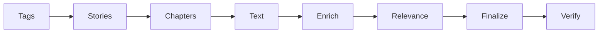
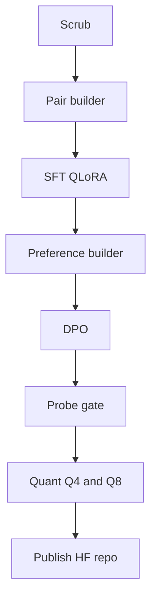
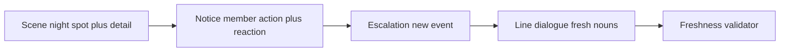
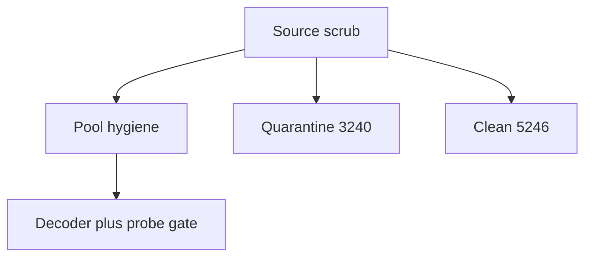
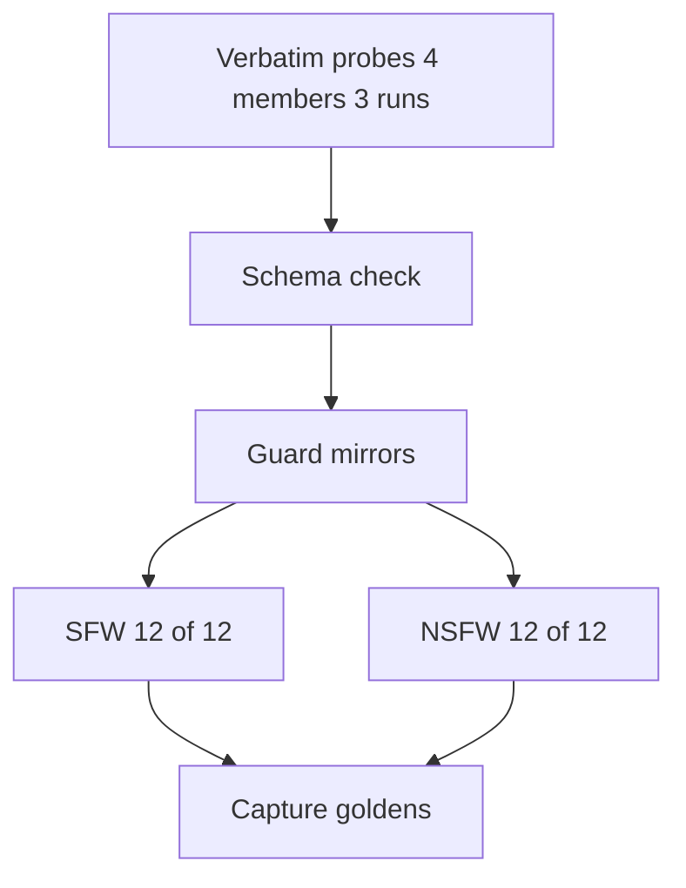

`tinyTanLLM-delulu-gemma` is a short form comedic BTS scenario generator built for a Discord `/delulu` command. It produces strict JSON with four keys, `scene`, `notice`, `escalation`, and `line`, under a `json_schema` constrained decoder at temperature 0.7 and a maximum of 150 tokens.

The model starts from `IlyaGusev/gemma-2-2b-it-abliterated`, a refusal abliterated Gemma 2 2B. It was trained with QLoRA SFT at rank 32 on 1,200 curated pairs, followed by DPO on 1,200 triplets. SFT reached an eval loss of 0.26. DPO reached an accuracy of 1.0, with the margin improving from 9.8 to 14.8. The release gate required 12 of 12 SFW probes and 12 of 12 NSFW probes to pass across 4 members and 3 runs each, with zero minors coded language. The released artifacts are SFT and DPO LoRA adapters with `Q4_K_M` and `Q8_0` GGUF quantizations in the private Hugging Face repository `tinyTanLLM-delulu-gemma`.

The remainder of this post explains the evidence behind these choices, beginning with the data, continuing through the memory constraint and the rejected alternatives, and concluding with construction, testing, and limits.

## 1. The opportunity

A narrow task allows a small model to succeed where a general model cannot. The bot required a specific voice, a strict output contract, a hard memory ceiling, and safety boundaries that hold under pressure. Each requirement follows from how the feature is used.

First, the voice is reader as protagonist with the member as initiator. It operates in two registers, playful SFW and consensual adult. Second, every reply must parse as JSON with four fresh keys, since Discord renders each key into its own card. Third, training must fit on a single 16 GB card, an RTX 4080 SUPER, while inference must run on CPU on a small VPS or laptop. Anything requiring 8 GB or more at runtime was therefore excluded. Fourth, all characters are adults aged 20 and above, with no school settings, no teen coded framing, no non consent content, and explicit content only where all parties are consenting adults.

No stock model satisfied all four conditions. The 0.6B Qwen stock build refused the consensual adult register entirely. Models in the 4B class were too slow and too heavy for the latency and memory budget. Furthermore, the Wattpad prior from the earlier prose experiment represented the wrong default, since it favored a passive member and a teen voice that had to be corrected rather than reused. As a result, the design brief became a small and fast model with reliable schema compliance and a consenting adult register, at a cost that allows CPU deployment.

## 2. What we knew before designing

### The corpus

The fundamental concept was to ground the model in a verified BTS fanfiction sample before attempting any behavioral training. Chapters were collected from Wattpad through BTS related tags, then filtered for a genuine BTS signal through tag, title, and description matches, or through at least two distinct BTS terms in the chapter text. This precision first filter was necessary because tag pages include recommendation carousels, and approximately half of the raw story list was unrelated work.

The verified dataset lives in `bts_corpus/dataset/` and is described in `docs/dataset.md`.

| Measure | Value |
| --- | --- |
| Chapters kept | 8,591 from 2,022 stories |
| Words and estimated tokens | 11,867,516 and about 15.4M |
| Train and validation | 8,419 and 172 chapters, from 1,982 and 40 stories |
| Split | 98 to 2 by `story_id`, so no story spans splits |
| Median chapter | 1,014 words, about 1.3k tokens |
| Views | plain prose in `train.jsonl`, structured header, and chat `messages`, one per run and never mixed |

The pipeline is resumable through discrete stages for tags, stories, chapters, text, enrichment, relevance, and finalization. The diagram below shows the order in which each stage runs.



It rebuilds with a verified sequence:

```bash
python bts_corpus/build.py relevance
python bts_corpus/build.py finalize 100
python bts_corpus/verify_dataset.py
```

Two details proved important for later work. The fetcher settles at approximately 1.8 requests per second, since rates above 2 requests per second trigger 429 responses from the text endpoint. In addition, every training row carries a `chapter_id` that joins back to `chapter_url` and author, which supports attribution or takedown. Rights remain with the original authors, and the corpus is retained for personal research rather than redistribution.

### The RAM constraint

Training runs in WSL2 Ubuntu with CUDA 12.x and Python 3.11 or 3.12, because Unsloth Triton kernels do not support native Windows. The memory budget shaped every subsequent decision.

The approach uses 4 bit base weights with LoRA adapters only, approximately 20 to 30M trainable parameters on a 2B base. It uses a sequence length of 512 for `/delulu`, in contrast to 2048 for the earlier prose experiment. This reduction is justified because a median prose chapter is about 1k words, while a delulu reply is under 150 tokens. It further uses gradient checkpointing through Unsloth, `adamw_8bit`, and bf16 on Ampere and later hardware. For deployment, the model ships as GGUF quantization, `Q4_K_M` for size and `Q8_0` as the quality floor, so inference runs on CPU RAM rather than VRAM.

### Candidate bases and methods

| Option | Why considered | Outcome |
| --- | --- | --- |
| Qwen3-0.6B stock with QLoRA in `finetune/` | Smallest option, and prose tuning worked | Rejected for release, since stock refuses the consensual adult register. Retained only as an exploratory prose baseline |
| 4B class instruction models | Better quality without training | Rejected, since latency and memory exceed the bot loop budget |
| Gemma-2-2B abliterated | Fits speed and register, refusal abliterated, 2B fits QLoRA on 16 GB | Selected |
| Full finetuning | Maximum control | Rejected, since VRAM and time costs are unjustified for a 150 token JSON task |
| Prompt only without training | Zero training cost | Rejected, since it could not hold the four key freshness and agency rules reliably |
| QLoRA SFT to DPO with GGUF | Teaches the default continuation, then trains away named failures | Selected |

## 3. The design that shipped

This section received the most iteration, since reliability had to come from structure rather than prompting.

The system has two paths, serving and training. Serving handles a Discord request end to end, while training runs offline through scrubbing, pair construction, SFT, preference construction, DPO, gating, quantization, and publication.




The JSON contract functions as the interface. Each key has one responsibility, enforced by both the trainer validator and the evaluation judge. The diagram shows how the four keys build on one another while the validator checks freshness across them.



- `scene` completes *You are at ___*. It names a night spot adults attend, with one sensory detail.
- `notice` completes *{Member} ___*. The member is the grammatical subject, with one bold action verb and a complement that shows reaction.
- `escalation` completes *Suddenly ___*. It introduces a new event with zero shared content words with `notice`.
- `line` is member dialogue beginning with `You` or `I`, with fresh nouns and zero overlap with `scene`, and without quotation marks.

Freshness is therefore a rule rather than an impression. The validator in `make_pairs_v2.py:valid_v2` rejects any pair where a content word repeats across keys, with the member name exempted, where `escalation` does not begin with `Suddenly`, or where `line` echoes `scene`. DPO then trains away four named failure shapes observed in practice. These are **flip**, where agency is reversed, **repeat**, where nouns are recycled, **reject**, where romance turns into a rejection plot, and **coerce**, where escalation becomes coercive. The coercive variant serves only as a train away signal.

Safety is structural in three layers. The diagram traces how quarantined chapters leave the pipeline early, while clean chapters continue through pool hygiene and the decoder gate.



1. Source scrub in `delulu/curate.py`. A keyword and age mention filter quarantined 3,240 chapters and retained 5,246. When classification is uncertain, the chapter is dropped. A false positive costs one chapter, while a false negative risks an unacceptable output.
2. Pool hygiene in `delulu/pools_v2.py`. Every SFT fragment is original and short. A `MINORS_BLOCK` list applies to all tracks, and every NSFW pair must carry a consent cue.
3. Decoder and probe gate. `json_schema` remains enabled, and NSFW probes fail the entire run on any minors coded language while requiring a consent cue in the output.

The reason for SFT followed by DPO, rather than additional SFT, is that each stage has a distinct role. SFT establishes member agency as the default continuation from a fresh base, without reusing the Wattpad prior. DPO then corrects the residual habits that SFT alone leaves behind, including template replay, noun echo, and agency flips, using 1,200 triplets that cycle through flip, repeat, reject, and coerce.

## 4. How it was built

**Scrub.** `python delulu/curate.py` produces `clean_train.jsonl`, `clean_valid.jsonl`, and `quarantine.jsonl` with a reason recorded per chapter.

**SFT pairs.** `python delulu/make_pairs_v2.py --n 1200 --nsfw-frac 0.4` produces `sft_pairs_v2.jsonl`. The construction starts from 12 golden outputs, each rewritten 4 times with new places and nouns. This is paraphrase rather than duplication, since duplicates would train the replay habit. Free combinations from the v2 pools then bring the set to volume. The final mix is 720 SFW and 480 NSFW pairs, balanced across 7 members, all validator passing, all with `system`, `user`, and `assistant` chat rows.

**SFT.** `python delulu/train_sft.py --model IlyaGusev/gemma-2-2b-it-abliterated --family gemma2` runs QLoRA at rank 32 and alpha 32 across all attention and MLP projections, with sequence length 512, effective batch 16 as 4 by 4, learning rate 2e-4, cosine schedule, 10 percent warmup, 5 epochs, a 90 to 10 split, and response only masking on `<start_of_turn>model`. Best retained eval loss was 0.26. Output is `delulu-sft-gemma-lora/`.

**DPO triplets.** `python delulu/make_prefs_v2.py` produces `dpo_pairs_v2.jsonl`, with one rejected variant per SFT pair rotating through the four corruption kinds.

**DPO.** `python delulu/train_dpo.py --family gemma2` runs with beta 0.1, learning rate 5e-6, 2 epochs, effective batch 16, maximum prompt length 256, and maximum length 512. Accuracy reached 1.0, with the margin moving from 9.8 to 14.8. Output is `delulu-dpo-gemma-lora/`, usable standalone.

**Quantization and publication.** GGUF exports produce `delulu-gemma-q4_k_m.gguf` and `delulu-gemma-q8_0.gguf`, uploaded to the private Hugging Face repository with both adapter folders and the model card in `delulu/MODEL_CARD.md` via `publish_hf.sh`.

The memory savings are concrete rather than incidental. The 4 bit QLoRA base replaces full weights, the 512 token window matches the short form task, checkpointing with the 8 bit optimizer limits training memory, and `Q4_K_M` limits serving memory. In our runs Q4 replayed templates more often than Q8. Consequently Q8 is documented as the quality floor and Q4 as the size default.

## 5. How it was tested

The harness in `delulu/eval_delulu.py` and `delulu/run_probes.py` runs verbatim probes, 3 runs per member at temperature 0.7, and judges only schema passing outputs against the release criteria and runtime guard mirrors. Outputs fail when notice lacks the member name, when line begins with the member name, when escalation echoes notice, or when line echoes scene. The diagram summarizes the gate that every release must pass.



The release bar requires every probe to pass all four keys on all 3 runs. The harness was calibrated against the pools first, after a hardcoded lexicon false failed valid outputs 0 of 12, and only then trusted for gating.

| Suite | Result |
| --- | --- |
| SFW across Jungkook, Yoongi, Jimin, and Taehyung, 3 runs each | 12 of 12 pass |
| NSFW with explicit consent line, consent and minors checks | 12 of 12 pass |
| Minors coded language across all runs | Zero |
| `Q4_K_M` against `Q8_0` | Q4 gated for release, Q8 retained as floor with less template replay |

Passing runs are captured through `capture_goldens.py` into `goldens.jsonl`, so regressions have a diff target in addition to a score.

## 6. Limits, trade offs, and next steps

A small model with small pools stays close to its training phrasing. Variety therefore comes from wider pools rather than cleverer prompts, since prompt cleverness does not survive quantization while pool diversity does. Word counts are not obeyed, because the model cannot count. Content demands work, while numeric demands do not. The Q4 against Q8 difference is also material, so Q4 ships for size and Q8 remains where quality matters most.

The corpus itself carries scope limits. It is a Wattpad sample reached through seed tags, with at most 25 chapters queued per story and language taken from author declarations. As a result, a small number of chapters are not in English, and some author notes and lists remain.

The next steps follow directly from these limits. These include larger fresh pools per member, harder DPO negatives drawn from observed failures, and periodic re gating on the verbatim suite before any republication.

## 7. Reproduce it

```bash
# dataset
python bts_corpus/build.py relevance
python bts_corpus/build.py finalize 100
python bts_corpus/verify_dataset.py

# safety and data, in WSL with bts-venv
python delulu/curate.py
python delulu/make_pairs_v2.py --n 1200 --nsfw-frac 0.4
python delulu/make_prefs_v2.py

# train, in WSL with CUDA
python delulu/train_sft.py --model IlyaGusev/gemma-2-2b-it-abliterated \
  --family gemma2 --data delulu/sft_pairs_v2.jsonl \
  --output-dir delulu/outputs/delulu-sft-gemma-lora
python delulu/train_dpo.py --family gemma2

# gate
python delulu/run_probes.py --base http://localhost:8080/v1
python delulu/run_probes.py --base http://localhost:8080/v1 --nsfw
```

Repo map: `bts_corpus/` holds the collector and dataset, `delulu/` holds scrubbing, pairs, trainers, probes, adapters with GGUFs, and the model card, `finetune/` holds the earlier Qwen prose experiment now superseded, `docs/dataset.md` holds the data card, and `decisions.tsv` holds the decision trail. Weights and dataset remain local and gitignored, while public artifacts live in the private Hugging Face repository.
