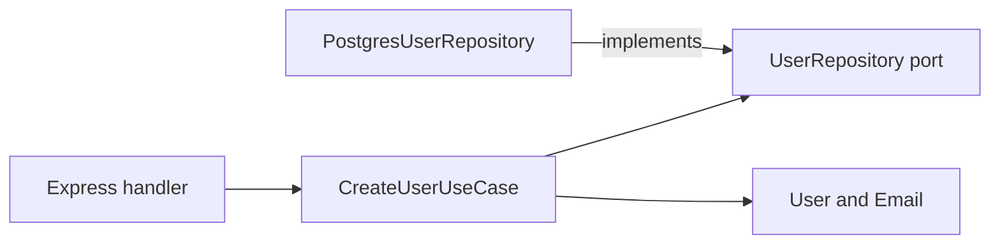

TypeScript clean architecture is a dependency rule before it is a folder layout: the domain and the service layer must not import a framework, and the framework depends inward through interfaces the domain owns. Here is how the layers map onto TypeScript, and where the pattern stops paying for itself.

## What clean architecture is

Clean architecture, as Robert C. Martin describes it, separates code into layers and fixes the direction of the dependencies. Outer layers depend on inner layers. Inner layers never depend on outer ones.

### The layers

```
┌─────────────────────────────┐
│       Infrastructure        │  ← DB, APIs, frameworks
├─────────────────────────────┤
│        Application          │  ← Use cases, ports
├─────────────────────────────┤
│          Domain             │  ← Entities, business rules
└─────────────────────────────┘
```

- The domain holds business logic and imports nothing from outside.
- The application layer holds use cases and the interfaces, or ports, they call.
- The infrastructure layer holds the implementations: databases, HTTP clients, mailers.

## Layers in TypeScript

### Domain

The domain holds entities: plain objects and functions with no framework imports.

```typescript
// domain/entities/User.ts
export class User {
  constructor(
    readonly id: string,
    readonly email: Email,
    readonly name: string,
    readonly role: Role,
  ) {}

  canAccessResource(resource: Resource): boolean {
    if (this.role === Role.Admin) return true
    return resource.ownerId === this.id
  }
}
```

Value objects keep validation next to the value it produces:

```typescript
// domain/value-objects/Email.ts
export class Email {
  private constructor(readonly value: string) {}

  static create(raw: string): Email {
    const email = raw.trim().toLowerCase()
    if (!email.includes("@") || !email.includes(".")) {
      throw new Error("Invalid email address")
    }
    return new Email(email)
  }
}
```

The private constructor is what makes that work. An `Email` reaching the database has already been validated, so no later layer has to check it again.

### Application

Ports are the interfaces through which the application reaches the outside world:

```typescript
// application/ports/UserRepository.ts
export interface UserRepository {
  findById(id: string): Promise<User | null>
  findByEmail(email: string): Promise<User | null>
  save(user: User): Promise<void>
  delete(id: string): Promise<void>
}
```

Use cases orchestrate the domain:

```typescript
// application/use-cases/CreateUser.ts
export class CreateUserUseCase {
  constructor(
    private userRepo: UserRepository,
    private emailService: EmailService,
  ) {}

  async execute(input: CreateUserInput): Promise<User> {
    const email = Email.create(input.email)
    const existing = await this.userRepo.findByEmail(email.value)
    if (existing) throw new Error("User already exists")

    const user = new User(
      crypto.randomUUID(),
      email,
      input.name,
      Role.User,
    )

    await this.userRepo.save(user)
    await this.emailService.sendWelcome(user.email)
    return user
  }
}
```

The use case depends on the `UserRepository` interface. It has no import of Postgres and no import of the HTTP layer, which is why it runs in a test with no container.

### Infrastructure

Concrete implementations of the ports:

```typescript
// infrastructure/repositories/PostgresUserRepository.ts
export class PostgresUserRepository implements UserRepository {
  constructor(private db: Pool) {}

  async findById(id: string): Promise<User | null> {
    const result = await this.db.query(
      "SELECT * FROM users WHERE id = $1",
      [id],
    )
    if (result.rows.length === 0) return null
    return this.toDomain(result.rows[0])
  }

  async save(user: User): Promise<void> {
    await this.db.query(
      `INSERT INTO users (id, email, name, role)
       VALUES ($1, $2, $3, $4)
       ON CONFLICT (id) DO UPDATE
       SET email = $2, name = $3, role = $4`,
      [user.id, user.email.value, user.name, user.role],
    )
  }

  private toDomain(row: any): User {
    return new User(
      row.id,
      Email.create(row.email),
      row.name,
      row.role as Role,
    )
  }
}
```

At runtime the call travels outward, from the handler to the use case to the repository. Every arrow below is an import, and all of them point inward.



## Wiring it together

The composition root is the one place that knows about every layer:

```typescript
// main.ts
const db = new Pool(connectionString)
const userRepo = new PostgresUserRepository(db)
const emailService = new SendGridEmailService(apiKey)
const createUser = new CreateUserUseCase(userRepo, emailService)

// Express route handler
app.post("/users", async (req, res) => {
  try {
    const user = await createUser.execute(req.body)
    res.status(201).json({ id: user.id })
  } catch (err) {
    res.status(400).json({ error: (err as Error).message })
  }
})
```

## Testing

The use case runs against an in-memory repository and a mock mailer, with no database and no HTTP server:

```typescript
// tests/CreateUser.test.ts
describe("CreateUser", () => {
  it("creates a user successfully", async () => {
    const userRepo = new InMemoryUserRepository()
    const emailService = new MockEmailService()
    const useCase = new CreateUserUseCase(userRepo, emailService)

    const user = await useCase.execute({
      email: "test@example.com",
      name: "Test User",
    })

    expect(user.name).toBe("Test User")
    expect(emailService.sentEmails).toHaveLength(1)
  })
})
```

## When it pays

| Scenario | Apply it? |
|---|---|
| Simple CRUD | No. Follow the framework convention. |
| Complex business rules | Yes |
| Several delivery mechanisms: API, CLI, queue | Yes |
| Microservices | Yes |
| Rapid prototyping | Not yet. Refactor when the rules stabilise. |
| Large team, long-lived project | Yes |

## Summary

The dependency rule costs little when the domain is complex and a lot when it is not. Apply the layers where business rules outlive the framework, and leave a CRUD screen as a CRUD screen.

## TypeScript clean architecture, in questions

### Where does the service layer belong?

In the use-case layer, not above it. A service orchestrates domain objects and calls out
through ports (plain interfaces) and never imports the adapter that implements them, which
is what keeps it testable without a database.

### Do I need an interface for every class?

No. Add a port only where an inner layer has to call outward. An interface with one
implementation and no boundary being crossed is indirection you will pay for on every
change.

### How do I find dead code in a layered TypeScript repo?

`knip`, or `ts-prune` for exports only. Layers help here: an unused adapter has no inbound
imports, so it shows up immediately instead of hiding behind a barrel file.

### Does this work with React?

Yes, at the edge. Components are the outermost layer and own fetching and rendering;
business rules stay in plain modules that unit test without a DOM.

### How do I stop an inner layer importing infrastructure by accident?

Path aliases plus an ESLint `no-restricted-imports` rule per layer. Aliases make the
violation readable in review, and the lint rule makes it fail instead of relying on
discipline.
