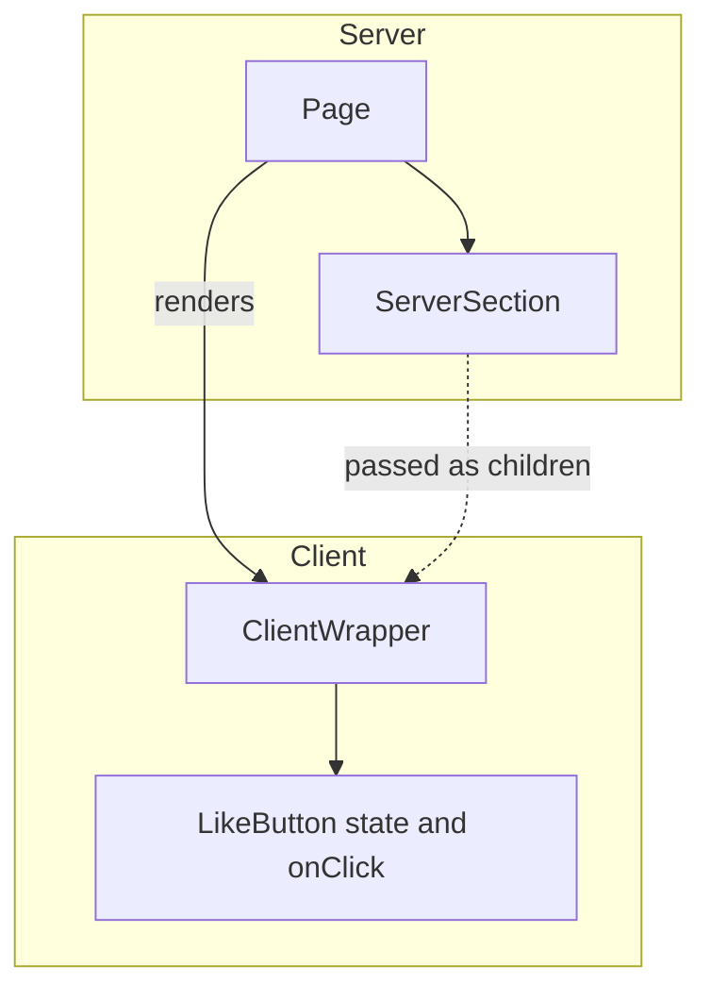

React Server Components (RSC) are components that run only on the server. Their code is never shipped to the browser and they are never hydrated, which is a different thing from server-side rendering. This covers what they are, how they relate to SSR and to React Router, and what streaming changes.

## The shift in mental model

RSC changes where a component runs. Instead of rendering the whole tree on the client, a component can now run only on the server.

### What changed

Before RSC, every component ran in the browser. Data fetching went through `useEffect`, client state went through a state library, and every component shipped to the client as JavaScript.

With RSC:

- Server Components fetch data, query databases, and read from the filesystem
- Client Components handle interactivity, state, and browser APIs
- The framework decides which strategy applies to which part of the tree

## Server and client components

```tsx
// ServerComponent.tsx: runs on the server, no JavaScript sent to the client
import db from "@/lib/db"

export default async function PostList() {
  const posts = await db.query("SELECT * FROM posts")
  return (
    <ul>
      {posts.map(post => <li key={post.id}>{post.title}</li>)}
    </ul>
  )
}
```

```tsx
// ClientComponent.tsx: "use client", runs in the browser
"use client"

import { useState } from "react"

export default function LikeButton({ postId }: { postId: string }) {
  const [liked, setLiked] = useState(false)
  return (
    <button onClick={() => setLiked(!liked)}>
      {liked ? "❤️" : "🤍"}
    </button>
  )
}
```

### The rule

Server components can import and render client components. Client components cannot import server components. A client component receives a server component as `children` or through composition.

```tsx
// Correct: the server page passes a server component into a client wrapper
export default function Page() {
  return (
    <div>
      <ServerSection />
      <ClientWrapper>
        <ServerSection /> {/* server component rendered as children */}
      </ClientWrapper>
    </div>
  )
}
```

The boundary follows the component tree. `Page` and `ServerSection` render on the server, and the rendered output reaches `ClientWrapper` as `children`.



## Data fetching

### On the server

Initial data no longer needs `useEffect` or a loading state:

```tsx
// Before: client-side fetch with a loading state
function Profile() {
  const [user, setUser] = useState(null)
  useEffect(() => {
    fetch("/api/user").then(r => r.json()).then(setUser)
  }, [])
  if (!user) return <Skeleton />
  return <div>{user.name}</div>
}

// After: server-side fetch, no loading state
async function Profile() {
  const user = await getCurrentUser()
  return <div>{user.name}</div>
}
```

## When to use which

| Scenario | Component type | Why |
|---|---|---|
| Fetching data from a database | Server | Direct access, no API layer |
| Clicks and text input | Client | Needs `useState` and `onClick` |
| Static content | Server | No interactivity |
| Third-party hooks | Client | Hooks only run on the client |
| Reading from the filesystem | Server | The browser has no `fs` |
| Animation with GSAP or Framer Motion | Client | Needs DOM access |

## Performance

Only Client Components ship their JavaScript. Server Components render to HTML on the server and stream that HTML to the browser, so the bundle contains nothing for the parts of the page that need no interactivity. The smaller bundle reduces parse and execution work in the browser and improves the [Core Web Vitals](/blog/designing-for-performance) that depend on it.

Start with Server Components by default and reach for a Client Component when you need interactivity.

## React Server Components, in questions

### How are RSC different from SSR?

SSR renders your component tree to HTML on the server but still ships the component code
to the browser and hydrates it. A server component is never hydrated: only its output
crosses the wire, so a heavy dependency used inside one costs the client nothing.

### Are React Server Components the same as using React Router?

No. RSC is a React capability; a framework implements the transport. React Router in
framework mode has server components, and the [Next.js App Router](/blog/building-scalable-web-apps-with-nextjs) has them. A plain
client-side React Router app does not, and adding a `<Suspense>` boundary there will not
create one.

### What does streaming change?

A server component is serialized as a stream, so the shell can be flushed first and a
slow subtree patched in later. The page stops waiting on its slowest query before it
starts rendering.

### When does a component have to stay a client component?

When it needs state, effects, event handlers, or a browser API. Mark those files with
`"use client"` and push them to the leaves, so the server renders everything above them.

### What is RSC like in TypeScript?

It is the same React types. There is no separate server-component type, so TypeScript
cannot stop you from calling a hook inside a server component. The `"use client"`
boundary is enforced by the bundler, not the type checker.
